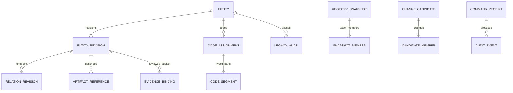

# MA11 — URMS Permanent Identity、正規化編碼、雙樹與版本化關聯

Revision `candidate.4`；Owner existing Registry／R05／Architect；AUTHOR_CHECKED／FORMAL_REVIEW_PENDING。SQL prototype/DDL/migration 未執行。

## Purpose／Source／Reuse

Owner A+：PostgreSQL draft/work/history/query 中心；Git 正式 identity/relations/contracts；ArtifactStore 詳細內容；existingWORK 管理 execution/acceptance。承接 F3 全部及 CG2；不重新設計 acceptedtradingidentity，URMS ID 不能作 brokerorderID 或 operator/financialaccount 替代。

## Canonical ID／Codes／Aliases

新 entity 採 UUID 一次分配、persist/export，不由名稱/碼/parent/hash 計算；revision 同樣 stableID＋immutablecontenthash。Git export 必含 ID，import 重用相同 ID；SQL 流水號可 local surrogate 但不作跨系統唯一身份。Entitykind 完整 typed，projectOwner 不隨多 projectmapping 改。

CodeAssignment＝catalog_scope＋namespace＋code_type＋typedorderedsegments＋format_policy_ref＋effectiveinterval＋entity_ref。Namespace 不是 split 字串；CodeSegment 有 ordinal、semantic_type、value_type、numeric_value/token_ref、widthpolicy。永久唯一性在不可變catalogID/entitykind/namespace/codefamily/canonicaltypedsemanticvector；CodeAllocation永久只歸一entity，retirement／format改版／不重疊時段都不能重配另一entity。CodeAssignment的effectiveinterval僅控制同一allocation呈現版次，不創造配置權。Human code 是 format 產物，raworiginalLegacyAlias 保留 context/source/revision/validity/target，alias 歧義不能 first-match。

| Input | Typed interpretation／scope | 必須拒絕的錯法 |
|---|---|---|
| P00 | program_phase；phase_number=0 width2；P catalog | 當原 legacyP0 同身份 |
| LAB-01 | namespaceLAB；wave_number=1 width2；originalWavecatalog | newFeaturecatalog LAB01 合併 wave 身份 |
| GAP-08 | gap_number=8 width2；gap_registercontext | 當 P08 integrationaccepted |
| GAP-07-TIME-001 | gap_number=7 width2；subdomain tokenTIME；item_number=1 width3 | TIME 誤作 namespace、001 當整 gapnumber |
| AUTO-IMP-003 | namespaceAUTO；workfamily IMP；package_number=3 width3 | IMP 當 numeric 或由 packageid 改 existingexecutionID |
| C01 | blueprint/calendar source vs GAP08 correctioncatalog 等 | 裸 C01globalunique、用字串 same 就 merge |
| P8／P08 | legacybrokerverification vs newphase | 只 zero-pad 就認相同 semantic |
| WO/EXEC/Evidence IDs | originalnamespace/opaquelegacyID＋typedreference | 強制重新編碼歷史 Receipt 引用 |

Parser 依 CodeTypeGrammar/FormatPolicy 選合法 segmenttypes/count/range；不靠 split('-')推語義。Rawalias 可保 exact 原 ID，無需全部重寫。改 format/newcatalog 新 assignmentrevision，oldaliases 不回改。

## 最小 Logical ERD／3NF

| Logical entity | Key／minimum columns／constraints |
|---|---|
| Entity | PKentity_id；project_owner、kind、created_source_ref、retirement_ref?；permanentimmutableidentity |
| EntityRevision | PKrevision_id；FKentity_id/priorrev、contenthash/hashdomain、sourcebinding、semanticpayloadref、createdactor/time；unique(entity,revisiontoken)；appendonly |
| Catalog/CodePolicy | IDs＋immutablecatalogscope＋namespace＋kind/grammar＋formatingrevision；policyversionfrozen |
| CodeAllocation／CodeAssignment/Segment | permanent semantic key→immutableentity；retirementtombstone；FKallocation/entity/catalog/policy；typedsegments；ordinalunique；format寬度不進永久key |
| LegacyAlias | rawtext/context/source/interval/targetrefs；lookupmayambiguous；noaliasasFK |
| RelationRevision | permanentrelationID/revisionID、kind、from/to exactrevision、qualifier/RelationValidity(source-snapshot或來源可證interval)、priorrev、source；FKendpoints、relationtypeallowedkinds |
| RegistrySnapshot/Member | snapshotID/revision/hash、source/parentheads、exactentity/relationshipmembers；immutablemembership |
| DraftHead | owner/scope/entity、currentdraftrevision、generation；separateAcceptedHeadprojection；CAS |
| ArtifactReference | id/ref/contenthash/version/media/privacy/requiredavailability/opaqueproviderlocator；bytesoutsideSQL |
| EvidenceBinding | evidenceID/revision、exactsubjectclosurehash、scope/type/source/qualificationlevel、receiptref；SQL 不 createacceptance |
| ChangeCandidate/Member | frozenmanifest/candidateID/basehead/expectedgeneration/ownerintent＋exactchanges；MA12 lifecycle |
| CommandReceipt/AuditEvent | unique(scope,commandid)＋payloadhash、outcome/receipt、actor/frontier、source；append-only |

Typed extensionpayload 只有 entitykind-specific attributes，可用 schema-validatedJSONB 避免大量未用 tables；核心 IDs/codes/endpoints/version/currency/sourcehash 要可 FK/index，禁止 allgraph 隱藏 JSON。Displayformattedcode、currentprojection、searchindex 為 derived cache 有 producer/version，不形成3NF 新 truth。Tasks 保原 WOreference，不能 SQL 直接 compiler。

## Trees／Typed Relations／Cycle Scope

ProductHierarchy 和 EngineeringWBS 是不同 graph；在一 snapshot/tree-scope 每 activechild 最多一 parent，rootexplicitROOT 不是 orphan。跨樹 manyparents 用 typedmapping，不混 parentedge；不同視圖的分類也用 categorizationmapping，不複製 entity。不限 depth，recursivequery 具有 visitedset/depthresourceguard，超 limit 報 INCOMPLETE 不當 PASS。

Types：PRODUCT_PARENT、WORK_PARENT、CAPABILITY_MAP、PHASE_MAP、IMPLEMENTS、REUSES、QUALIFIES、ACCEPTANCE_APPLIES_TO、DEPENDS_ON、SATISFIES、ADDRESSES_GAP、SPECIFIES、CODE_IMPLEMENTATION、EVIDENCE_FOR、DERIVED_FROM、SUPERSEDES、SPLIT_INTO、MERGED_INTO。CAPABILITY_MAP 保存歷史 leaf→capability，不以 PHASE_MAP 代替。reuse 不授權 implementation，qualify 不 accept，EvidenceFor 不 automaticcredit。Relationtypeconstrainttable 在 candidatecatalog 中唯一 owner。

DependencyDAG 驗整個 proposedsnapshot 的**effective active dependency closure**，含跨 project/version/importedcontractedges；不能只驗本 patch 新增邊。產品/工程 parentcycles 獨立驗；dependencyedge 方向 dependent→prerequisite，topologicalgate 反向 consumer。歷史 derived/split/merge 關係不參與 runtimeeligibilityDAG 但不得循環 lineage；跨 projectref 缺 source 不能假設無 cycle 或 READY。

## Move／Split／Merge／Retire／Versioning

Move 保 entityID、新 parentrelationrevision、新 snapshot；acceptedoldparent 不可 in-placeupdate。Rename 新 entityrevision/codesalias，不斷 WO/Evidenceexactref。Split 舊 parentfeature 歷史保留，三 newfeature 各 newID＋SPLIT_INTO；originalID 不是悄悄其中一子。Merge newentityID＋MERGED_INTO，舊 refs 仍 resolve；retire 停止 futureadmission 而不刪舊關係。無 semanticchange 的 regroup 不用 newfeatureID。

共享功能唯一 owningproject/owner，consumer 跨 projectREUSES/IMPLEMENTS refs；consumer 不得 forkwriteoriginregistry 或 doublecredit。有效時間 businessinterval 與 recordedrevision/frontier 分開；draft 與 accepted 是不同 revision/snapshotmembership，不能同 row accepted=trueflip。

## Transactions／CAS／Replay／Indices／Long History

Scoped RegistryWriter 角色可 draft；formalProjectionImporter 只 applyMA12publishedsnapshot。SQLtransaction 寫 revision/relations/snapshot/commandreceipt/eventoutbox/headCAS 同 commit；檢查 FK、unique、graphclosure、generation；沖突409 重算不覆蓋。Serializable 或 scopeadvisorylock＋generationCAS，implementation 須兩 connectionprove 防 write-skew，purefake 不能證。

Index：entity/projectkind；revision(entity,recordedfrontier)、code scope/typednumeric/token；relation(fromrev,kind)/(torev,kind)/snapshotmembership；command(scope,id)unique；artifact hash/reference；audit(scope,frontier)。遞歸 query 從固定 snapshot 取 edges，不 joinmutablehead。大量 event 按時間/project partition 候選，archive 保持 crosspartitionreferenceclosure；正式 snapshot/receipts 不能 retention 刪。GC 僅無任何 accepted/draft/backup/reviewpin 的 private 可再生 bytes，不刪永久 identity。

## Interface／Security／Git Rebuild／Acceptance

API registry/registry-candidates/relations/aliases read/draft；editor 權限 scope 無 formalacceptance 能力。Git Registry 保存完整實體 revision、typedcode/alias、樹/relations、snapshotmembers、sources/contracts/artifactavailability/evidenceexactbinding；unknown/privatebytes 保 opaqueplaceholder。Reimport 同 ID 同 hash 冪等、sameIDdiffhashconflict；SQLclearempty 后從 Git 同 IDs/relations，不製造 Acceptance。

A–L 反例：C01collision/移動 LABfeature/Deliverable 三 Tasks 不增 weight/Feature 三 Phases/parentancestorcycle/depcycle/rename 不斷鏈/splitmerge 歷史/gitimportsameIDs/717edge 不增2137/multisegmentparser/draftaccepted 不同版本，分別必須通過正例並拒絕反例。新增：跨 project hidden cycle、concurrentparentswrite-skew、samecommanddifferenthash、retiredrequiredsource、舊 evidence 綁新 revision。

客觀驗收：Git 資料 closure 完整、semanticcodegrammar 可驗證、dualgraph 無環無誤孤兒、versionexact、weightconserved、singlewriter/receipt/replay、acceptedoldblobsimmutable。本輪 source/model 檢查；PostgreSQLconstraints/concurrency/performance 另資格。WORK 須帶邏輯模型＋testfixtures＋Gitimport/exportschema，無真 SQL 執行權限。Knownlimits：formalRegistryfreeze 需獨立 review/adoption；退役code永久保留與snapshot/temporalimport依新companion閉包、actualSQL/Indexbenchmark 未執行。

## 本次有界補充契約

[REGISTRY_EXPORT_ADAPTER.md](REGISTRY_EXPORT_ADAPTER.md) 為本章不可省略的候選 companion；typed resource/obligation、T12 witness、export adapter 與 exact dependency/source bindings 必隨章節 subject 一起編譯及審核。原 accepted predecessor 不變。

## RCG02 Cohesive correction successor

[REGISTRY_IDENTITY_AND_VALIDITY_CONTRACTS.md](REGISTRY_IDENTITY_AND_VALIDITY_CONTRACTS.md)與[REGISTRY_SOURCE_BINDINGS.candidate.v1.json](REGISTRY_SOURCE_BINDINGS.candidate.v1.json)是本章必要exactsubject；永久allocation/tombstone與typedvalidity由MODEL/TYPE companion承接。原accepted來源不改。

## Candidate.5 有界修正承接

Registry exact body pages and compound proposeRegistry body capture producer are mandatory. new_revision_ref consumed only after immutable named capture mapping; entity/revision/relations/codes/aliases retain original identity rules.

唯一詳細契約：`BODY_CAPTURE_READBACK_CONTRACTS.md`。原已接受範圍與尚未完成qualification保留。

## Candidate.5 有界修正承接

32個B3需求新Revision，原v3完整正文與v4不可匯入衝突觀察分開；所有Current Source/Endpoint/Unit/Snapshot/Export同新version。

唯一詳細契約：`REVISION_HISTORY_REPAIR.candidate.5.md`。原已接受範圍與尚未完成qualification保留。

## Cycle 02 有界後繼契約（設計候選；沒有採納或施工授權）

本章的受影響消費者使用 `MA-ARCH-REVIEW-v6-CYCLE02` 的 MODEL／TYPE／API 精確版本。來源與 plan revision 是 `candidate.6`；傳輸協定是獨立的 `MA-DTO-v6`。不得將 `candidate.4/5/6` 當 wire alias。原接受 P00 設計、永久身份、舊 Wave／Feature 語義及 v5 完整前驅 bytes 保留。

Registry：`CC02_AUTHOR_ADDENDUM.candidate.v6.md`、有限內部 producer allowlist、source-file resolver 及封閉來源正文型別。PAPER／compiler／wire／單元：`ENGINEERING_ADDENDUM.candidate.v6.md`。resolver 依原來源 owner、權限、immutable source bytes 與 schema 驗證；capture、索引與 A/B protection 不能互推。compiler 的 HOLD 和 READY 都固定完整輸入；source-compatible 設計檢查與 qualified producer result 分開。

本輪具體測試世界是合成設計預期值，`EXPECTED_NOT_EXECUTED`，不代表任何實際 DB、Broker、PAPER、Controller、還原或執行。`95_OPERATION_VALUE_COVERAGE.candidate.v6.json` 明列尚未補足的正例；negative wire case 不替代 positive domain oracle。舊 v5 fixture 原文保留，但只能作前驅/版本相容或回歸輸入，不能被推導為本輪當前 wire 實作證據。
