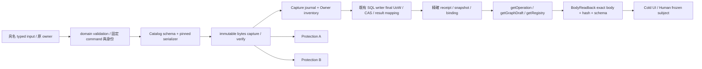

# CC02 正文 capture、readback 與 cold hydration 契約

Subject `MA-ARCH-REVIEW-v5-CYCLE01`；Revision `candidate.5`。本件為 Architecture Owner 作者候選；獨立 Reviewer 未執行本件 re-review。SQL／API／BFF／React／跨語言 serializer／交易／crash／A/B provider 的實際資格驗證均 `NOT_RUN`。R01/P00、原 Human 授權、既有 domain writer、Gate、永久身份與 historical acceptance 均由既有 authority 管理。

## Summary／問題與選擇

Cold client 需要具名且可驗證的正文。`ContractRef` 與 `OperationReceipt.result_ref` 是精確引用，不能替代 graph nodes/edges、ArchivePlan 的目的與 duplicate/safety 預覽、BudgetAllocationPreview 的實際配置，以及 Registry 行正文。

本件選擇一個機制：**具名 Body Catalog → immutable TypedBodyBinding → versioned BodyReadback**。沿用 95 個 operation ID、methods、paths 及既有 owner；只有候選 companion wire profile 明確改版。原 `OperationReceipt` 與 `ReadEnvelope` closed DTO 保持原型別。原 Artifact bytes 下載流程保持可使用。

Capture、SQL index、A 與 B 不是分散式原子交易。Capture 成功但 index 失敗仍保留 journal 與 Owner inventory；不產生假 candidate／result 成功，也不從已捕捉的 prepared receipt body 推論交易已提交。

## Analysis／具名型別與 catalog

`BODY_TYPE_CATALOG.candidate.v5.json` 列出有限的 `body_type`、`dto_version`、`serializer_id`、schema exactref、schema/type/enum dependency closure、准許 producer／reader 和 owner。Body type 不能從 arbitrary artifact bytes、class name、URL、OS path、client cache 或名稱猜測。未知版本、欄位、kind、schema 或未解決 dependency 不得解碼成正文；回 explicit unsupported／unverifiable。

Root 必須在所有 candidate.5 model/type 片段整合後重新編譯 catalog schema hashes，特別是 BudgetAllocationPreview／Receipt 的 successor 欄位。作者 fragment 隨附的 catalog 是整合前作者來源型別 snapshot；禁止把其舊 budget serializer digest 當成新模型的 digest。`finalize_catalog.py` 僅讀整合後 contracts 並把 final author catalog 寫回本 fragment directory，Root 再循序接入 candidate。

Registry semantic payload 採具名、closed 的 `RegistryEntityRevisionV5` 與 source-row adapters。原 frozen requirements／features／historical／P deliverables／P phases／accepted core／design deliverables 行 shape 保存在 `BODY_SOURCE_ROW_SCHEMAS.candidate.v5.json`，未知欄位不能進 parser。`ExecutionUnitPlan` 使用其既有具名 contract。來源中的 `accepted`、historical status、正式 credit 等原文資料只作來源正文；不產生本輪 acceptance。

## BODY_HASH_RULES_V5

| 軸 | 精確規則 |
|---|---|
| 原始來源 | `BodySourceBindingV5` pin 完整 source ArtifactRevision／CaptureReceipt／`raw-bytes-sha256-v1` hash，來源 row 使用 catalog 准許的 exact JSON pointer。原 source raw bytes 不正規化。 |
| Body bytes | `content_byte_hash = SHA256(exact immutable serialized artifact bytes)`，domain `raw-bytes-sha256-v1`；捕捉後不改 encoding、BOM、newline 或欄位。 |
| Model semantic | `SHA256(UTF8("ma-body-model-canonical-sha256-v1\n") + canonical({body_type,dto_version,schema_ref,body}))`；只排除 body **root** `ref.source_hash` 以避免 own-hash cycle，其他 root ID/revision/owner/hash_domain 與所有 nested exactref hash 保留。集合依既有 schema 排序，ordered arrays 保序，不遞迴展开引用物件。 |
| Subject sourcehash | 原 `subject_ref.source_hash/hash_domain` 按其原 domain 驗證，不用 body bytes hash 或 model hash偷換。若 subject 明定 model-semantic domain，要求 hash 相等；legacy source-domain subject 需 exact original source/schema/body mapping。 |
| Schema | `ma-body-schema-sha256-v1` + LF + canonical named model/type/enum/union closure；schema 邏輯 digest 與其 source file raw hash 是兩件事。 |
| Catalog | `ma-body-catalog-canonical-sha256-v1` + LF + canonical catalog payload；排除 catalog_ref 自身。 |
| Binding | immutable subject/body/schema/scope/source mapping；availability、as_of、auth observation、SQL index、A/B metadata 不進正文 semantic hash。相同 subject revision 對不同正文 binding 必 immutable conflict。 |

Canonical grammar 繼續使用原 `LOGICAL_SCHEMA_CONTRACT.md` 的 UTF-8／無 BOM／sorted object keys／duplicate-key reject／safe integers／string decimal／UTC／typed currency/unit 規則。跨 Python/.NET/TS 必有相同 golden bytes；作者 checker 只做合成資料，不能冒充實際三端資格驗證。

## Producer／合法 capture 與身份

Graph、ArchivePlan、BudgetPreview 等由原 E/G owner 計算 immutable result，以 pinned catalog serializer capture exact body。`result_ref` 只有在原 owner 的 authoritative final result mapping committed 後才暴露。未提交／索引失敗的 staging bytes 即使存在，也不能作 `COMMITTED`、accepted、budget effect 或 broker effect 證據。

`proposeRegistry` candidate.5 接受 `RegistryProposalRequestV5`：finite `body_submissions`、typed `RegistryChangeV5`、exact base snapshot、完整 connected graph heads、source refs。它在同一既有 command 內先完成正文 capture phase，才把 local body key 解析為原 `RegistryChange.new_revision_ref`。

1. 驗既有 editor 的 project／environment／resource／action 權限，actor 由 server context 取得。命令先重算 canonical payload hash。
2. 原 Registry writer staging transaction 以 unique `(scope,commandID)` 原子保存 command hash 與 local slot → allocated identity/revision mapping。同 command 同 hash 的併發只取得同 mapping；不同 hash 在配置 ID 或 capture 前拒絕。
3. `CREATE_NEW_DRAFT` 明確配置一次新永久 entity／revision；`UPDATE_EXISTING_DRAFT` 必帶 existing entity、exact prior revision、generation CAS，保持 entity ID，只配置 successor revision。配置採一次生成與保存的 UUID，不由名稱／parent／hash 派生 production identity。
4. IMPORT／Git rebuild 使用既有 verified importer，永遠保留 supplied permanent entity ID／revision ID；同 revision 不同 bytes 拒絕，不經上述新 ID allocator。不為 source 原文重配身份。
5. 同 batch 的 `LOCAL_DRAFT` 僅允許 schema 明定 FK paths。Source／catalog／policy／authority refs 必須 `EXISTING_EXACT`。新 relation 的 `RegistryRelationValidityDraftV5` 可選 exact existing snapshot，或明示同命令 `PROPOSED_CANDIDATE_SNAPSHOT`；後者由 server prepared snapshot identity 解析，不能提交任意 guessed ref。解析所有 new endpoints 後，用原 allocation permanence、RelationValidity、FK、complete cycle-scope、source-membership 規則驗證。
6. 捕捉 immutable bytes、verify equality、append capture journal 與 Owner inventory；缺來源、source/schema 不符或 capture failure 不得產成功正文引用。
7. 原 writer final UoW 重驗所有 connected graph heads/CAS，保存 candidate／immutable result binding／OperationReceipt／outbox。此處只有 `DRAFT`，沒有 accepted=true、formal head adoption、Git publication 或 runtime grant。
8. Capture 後 SQL 失敗，owner inventory/journal 保 bytes、`INDEX_FAILED` 與相同 command 身份；query receipt／reconcile，禁止改 command ID 盲目重送。它不是新增 acceptance engine。

舊 profile 的 bare `new_revision_ref` 只能在精確 existing body binding、capture、schema、source、scope/membership 全部可驗證時 adapter；缺任何項即拒絕，BFF 不能自己添加正文或發明 producer。

新 Registry draft／proposed snapshot 的 source-hash domain 選 `raw-bytes-sha256-v1`，對應精確捕捉的原 submitted typed payload bytes；catalog 准許的 local slot selector 與原子 prepared ID mapping 指明該新紀錄的來源。解析後 final body 與 snapshot membership 另外保存 BodyBinding model-semantic hash。如此 reciprocal entity/revision/snapshot refs 不遞迴計算彼此 semantic digest；同 ID/revision 不同 final body 仍由 immutable binding 拒絕。Imported refs 仍完全保留原 source-hash domain／hash，不換成此新 draft domain。

## Consumers／cold read 與 preview

| Operation／資料 | candidate.5 wire 與步驟 |
|---|---|
| `getOperation` | `ReadEnvelope.data = OperationReadbackV5`，內含原 receipt、原 producer operation ID 與有限 typed result readback。只有 operationID 時先 `result_body=NONE` 取得 exact receipt/result/snapshot，再 `REQUIRED` 查 exact result。Pending／unknown 沒有虛構 result。 |
| `getGraphDraft` | `GraphDraftSelectionV5.EXACT_REVISION` 要 exact revision/snapshot；`HEAD_AT_READ` 是明示 mutable owner-head lookup，在單一 captured readcut 回 exact graphref／snapshot／headgeneration。之後 reload pin refs；回 `GraphDraftReadbackV5`，nodes/edges 與必要 nested closure 來自 server body。 |
| `listGraphDrafts` | 回原 `GraphDraftView` 集合與 ReadEnvelope snapshot；它只是 discovery，沒有假裝 refs 是 nodes。Selected body 走上項 exact read。 |
| Archive Human preview | `createArchivePlan` receipt → `getOperation` actual ArchivePlan →顯示 source bytes/hash、destination namespace/filename/generation、action、licence/safety/duplicate/conflict/warnings →既有 Human decision bind body → `executeArchivePlan`。 |
| Budget Human preview | preview receipt → `getOperation` actual BudgetAllocationPreview → 顯示 `manual_capital_reference`、reduced Rational `budget_ratio`、computed `budget_total`、allocation 與 baseline cut/reservation/generations/warnings →既有 Owner decision bind body →confirm/revise。reference_amount alias 不能當 total。 |
| `getRegistry` | `ReadEnvelope.data = RegistryBodyReadPageV5`，exact snapshot + `RegistryBodyQueryV5`，finite row types／max200 body page／query-snapshot-scope-schema-permissionepoch bound cursor。TREE 依具名 relation graph scope選 Product／Engineering／Crosswalk；EXACT_MEMBERS 逐一驗 snapshot relevant closure membership。 |
| `getReviewSubject` | `ReadEnvelope.data = ReviewSubjectReadbackV5`，frozen roots/relevant closure body pages；required body 不完整時無 COMPLETE review claim。私人來源正文權限與 public metadata permission 分別驗。 |
| `getArtifactContent` | `ArtifactContentReadV5.BINARY_DESCRIPTOR` 包原 ContentDescriptor；`BODY` 要 exact binding/subject/type/schema/read snapshot，path ID/revision 必等 binding.content_artifact_ref。不能把 domainentity UUID當 artifact UUID。`getArtifactBytes` 原 byte stream 與短期 handle 授權再驗契約保持。 |

Registry readback 必能顯示永久 RegistryEntity、EntityRevision 原正文、retirement、Relation kind/direction/qualifier/endpoints、typed CodeSegment／CodeAllocation／CodePolicy，以及 LegacyAlias 原 raw/context/source/target/validity。Mapping 不算工作量，alias 不作 identity key。樹 query 顯示 exact roots，不把缺父／缺 endpoint 假裝 root。超 resource limit 回 partial/INCOMPLETE，不能稱 full graph validation。

Cursor 只能來自該 query／snapshot／scope／schema與 permission epoch。Body page 的每列有會員證據；列自身與 source Artifact 逐一驗權限，不讓公開 snapshot 包裹 private bytes。可見 metadata 但無 raw-body 權限可明示 REDACTED；連 metadata存在性亦無權限時回 coarse 403，不列該 object/hash/schema。

## Human binding 與 stale／race

`BodyConfirmationBindingV5` 保存實際取得的 server subject/binding/model hash/raw byte hash/schema/read snapshot/scope，寫入既有 Human／Owner decision receipt 的精確 subject。UI 只有 `AVAILABLE + VERIFIED + CAPTURED_VERIFIED` 且 required closure complete 才能啟用確認；任意 ref／input／cache／receipt 不可替代此 body。這是 exact subject binding 與 UI 驗證契約，不聲稱能證明人的認知閱讀。

Confirm／execute 仍在 effect boundary 驗原授權、expiry、AccountCut／reservation frontier／generations、source bytes、target safe namespace/generation與原 domain invariants。頭或cut改變必409並要求新 preview／decision。Read snapshot 保存歷史一致性，不保存已撤銷 grant；取 metadata後撤銷 body/source權限，resolver boundary 仍403。

## Availability、Integrity、Index 與 Protection

| 事實 | 獨立狀態與判斷 |
|---|---|
| Capture | CAPTURED_VERIFIED／CAPTURE_PENDING／MISSING／CORRUPT／UNKNOWN；receipt pin 原 bytes。 |
| Availability | AVAILABLE／MISSING／UNSUPPORTED_SCHEMA／INCOMPLETE_CLOSURE／REDACTED／DEPENDENCY_UNAVAILABLE／UNKNOWN；只在可合法解碼完整 required body 時 AVAILABLE。 |
| Integrity | VERIFIED／UNCHECKED／HASH_CONFLICT／SCHEMA_INVALID／UNKNOWN；有 bytes 不代表 hash/schema 相符。 |
| SQL index | INDEXED／NOT_INDEXED／INDEX_FAILED／UNKNOWN；index 本身不保證 bytes 存在，更不授命令成功。 |
| A／B protection | 各自 NOT_REQUESTED／PENDING／VERIFIED／FAILED／UNKNOWN 與自己的 ProtectionReceipt；A verified不推出B，兩者也不授讀取或Acceptance。 |

`BodyReadbackV5.payload` 在不符條件時 absent。不可給空 nodes／空 relations／0 budget 充當 MISSING。Outer ReadEnvelope coverage 必承接 nested gap；只有完整 query 成功且 zero selected members，有 positive complete-empty proof 才能 `EMPTY_VERIFIED`。

## Error 與 retry

既有 canonical `ErrorEnvelope` 與 `ERROR_RETRY_DISPOSITION_TABLE.json` 的 `architecture.transport_error.v2` 控制 outgoing vocabulary：401 AUTHENTICATION_REQUIRED；403 RESOURCE_SCOPE_DENIED；404 RESOURCE_NOT_FOUND；409 CAS_OR_HASH_OR_ALIAS_CONFLICT；422 SEMANTIC_VALIDATION_FAILED；429 RATE_LIMITED；503 DEPENDENCY_UNAVAILABLE_WITH_RECEIPT_WHEN_EFFECT_POSSIBLE。403 不洩私人存在性。retry/effect 必按表中證據分支；未知或可能已提交 command effect 先 QUERY_RECEIPT，不盲重送。預先驗證拒絕才可 NO_EFFECT_PROVEN，read effect 為 NOT_APPLICABLE。已知 receipt outcome 但 body 缺失可 200 加 explicit readback gaps。RESOURCE_DENIED、RESOURCE_OR_REVISION_MISSING、CAS_OR_HASH_OR_CURSOR_CONFLICT、DEPENDENCY_OR_OUTCOME_UNKNOWN 僅為表中明列 version 的 incoming legacy aliases；不得標成 v2 outgoing，未知 version/code 保持不重試並查可知 receipt。

## Alternatives／推薦

獨立新增十餘 getter 可解正文缺口，但會把 serializer/hash/privacy/error/member規則重複於多 route。只內嵌正文的所有 response 可簡化首次顯示，仍需 cold artifact/review resolver與 capture producer。選定 catalog+binding、在既有 read operation 的 versioned companion 使用相同 typed readback，讓所有路徑共享精確性與權限條件。

## Risks／qualification 邊界

1. Final catalog 必重算整合後 schema／serializer hash，不能混 v4 與 v5 DTO。未解決 type/enum dependency 必資格 gate拒絕。
2. 本件 staging transaction／capture journal／final UoW 是設計契約；actual PostgreSQL unique、兩連線race、durability/crash、.NET/TS/Python bytes與browser permission/E2E 仍未執行。
3. 舊 refs 無可信 body capture mapping 時保持 `MISSING / UNVERIFIABLE / UNSUPPORTED_SCHEMA`，不可事後回填為原時點 capture。原來源與歷史 acceptance immutable。
4. Research MODELER/provider 只能讀 allowlisted、redacted 研究DTO；不取得 SQL credential／transaction／Git publish／runtime／broker權限。正文建議仍由原 writer驗證。

## References

Machine合併片段 `CC02_READBACK_FRAGMENT.json` 含 models/structs/enums/API/UI/unit I/O／正反/race/crash oracle與每份來源 raw SHA256。Latest review raw counterexamples 保留 `V4-AUTHREG-IF01`、`LT-V4-BODY-01`、`V4-APIEXEC-NF01`。Root 整合與 fresh independent re-review 仍為下一 barrier；本作者文件不自授 PASS／ACCEPTED／implementation eligibility。
