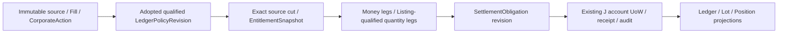

# Economic Resource / Settlement Contract — candidate.3

Owner：C/D reference、G risk/capital、H OMS、J account economic authority、K persistence。採 versioned companions；ADR-001/ADR-002、原 economic writer 及 canonical SEALED terminal 均受保護。

## 完整來源鏈

EconomicOrigin 為 ASSIGNED／EXTERNAL_UNASSIGNED／SYSTEM_ACCOUNT 三分支。ASSIGNED 固定 OriginBinding；EXTERNAL_UNASSIGNED 固定 ExternalFillProvenance，保留人工／未知原生單來源，無 fake intent/group/release；SYSTEM_ACCOUNT 代表有原始來源及政策的帳戶層事件，不能用空來源偽裝。legacy origin_ref 僅是 ASSIGNED 的相等投影，外部／系統分支為空；API、EconomicEvent、EconomicPayload 與 Ledger 消費端採同一分支。

InventoryLotRevision 固定 listing、inventory account、原 origin、acquisition economic event、unit/cost/source cut/policy。InventoryLotSelection 採 EXACT_LOTS，或在已採納 policy＋exact cut 下解析 eligible lots 並保存結果；不能在套用時任選另一 group 的 lot。incoming leg 新 lot 由原 source 決定；outgoing leg 必明列可用且歸屬合法的 lot refs。

QuantityLeg 固定 affected/delivered listing、signed quantity/unit、inventory account、lot selection、source、value date、origin 與必要 entitlement snapshot。SettlementMoneyLeg 固定 ledger account、signed Money/currency、value date、原 source/origin。來源不足或 asset profile 未 qualified，保留原始證據並 HOLD，不產生可用資源。

## 狀態、交割與公司事件

SettlementObligation 是 source-bound 的經濟義務，與 CONFIRMED 實際交割分開。EXPECTED → PENDING_MATCH → CONFIRMED；FAILED/DISPUTED 保持不可交易的負擔與 reconciliation；修正採 successor revision。CONFIRMED 必有可信 confirmation、exact resource legs、account/calendar/policy，不能只因日期到達就確認。

trade date、value date、record/ex/pay date、event effective/recorded time 分開；received time 不代替 causal frontier。應收款、票息、未交割庫存、保證金與可動用現金依 LedgerPolicyRevision 精確區分。FX 保存兩幣 legs；合併報表的 base currency 不是實際可轉移資金。

CorporateAction 的 ratio/cash 為相等檢查的衍生摘要；真正歸屬來自來源版本、eligible-lot EntitlementSnapshot、listing legs、cash legs、fraction/entitlement rule、SettlementObligation。action terms 更正不得追溯改寫已接受 Fill/origin；新來源矛盾及 sealed economics 依原 J/ADR authority 處理。

帳戶 UoW 原子保存 mutation、receipt、economic journal/audit/outbox；同 source/event 重送不得雙重產生 obligation 或 Ledger credit。projection 重算只能重建已接受經濟事實，不能再次 economic apply。任意新 event-type/asset profile 欠缺來源、採納或 qualification，拒絕套用而非以期貨公式填補。

## 可施工反例／金額測試

以下為明示合成 fixture，不代表任何商品的真實交易或公司事件規則：

| Fixture | 預期與拒絕條件 |
|---|---|
| G1 的 60 units、G2 的 40 units；confirmed 2:1 split | 原 record-cut entitlements 120/80，分別綁原 lot/group；不得只產生 account 200 後再依當日 group 比例分配 |
| G1 於 record date 後賣出 | entitlement 仍綁原 record-cut，不能以今天持倉重算既有 dividend；更正另建 successor |
| External native fill，未知 strategy | EconomicOrigin=EXTERNAL_UNASSIGNED；原 source/account/listing 可查且 qualification 足夠才 apply；group 欄位不補假值，原歸屬待 lawful successor |
| 實物履約，affected/delivered listing 不同 | option/underlying quantity legs、cash legs、lot selection、calendar/profile/confirmation 均完整；缺一資源不得 apply |
| 應收款 100、actual cash 尚未確認 | receivable 與可用 cash 分開；capital 不得把同一應收及現金計兩次 |
| obligation 同 event 重送兩次 | 同內容原 receipt/no-op；同 identity 異內容 CONFLICT；沒有兩筆資源 credit |
| canonical SEALED 後 late fill 矛盾 | INTEGRITY_CONFLICT、保 bytes/HOLD，禁止 append economics、new resend 或自行修舊事件 |

上述 wire/model 與合成反例僅為設計收斂。真正各資產 ledger/valuation/settlement golden fixtures、兩連線 PG crash/UoW、broker callback/recovery、PAPER integration 必由合法 WORK 與 Independent Reviewer/Intake 分別 qualification；本輪未執行。
