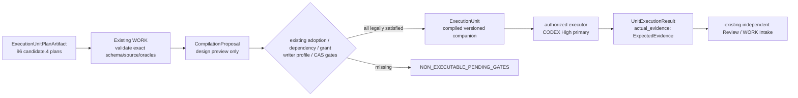

# Execution Unit Plan → Existing WORK Compiler Adapter — candidate.4

Owner＝既有 WORK Compiler／R03／R07／Result Intake。此 companion 修正 plan、編譯 DTO 與實際結果的型別混用；沒有建立第二個 Compiler。原 closed package／execution／claim／invocation schema 與已接受 R01／R03／R04／R05／R07 全部保護。

## 四種不同物件與單一寫入責任

1. `ExecutionUnitPlan` 是原有 plan artifact 的 reference wrapper。`ExecutionUnitPlanArtifact` 是 `EXECUTION_UNITS.json.units[]` 的 raw 計畫物件，由 `EXECUTION_UNIT_PLAN_SCHEMA.json` 驗證。raw plan 不是已編譯 DTO。
2. `RequiredEvidenceContract` 是**執行前的需求**：哪些變更、來源、命令、結果、失敗與成本資料必須回收。其 test IDs／required categories 不是實際執行結果。
3. `ExecutionUnit` 是 WORK 依法解綁後的版本化交換 companion；`expected_evidence: RequiredEvidenceContract`。舊閉合 schema 不直接加欄，使用既有 extension adapter 或授權 successor；未支援 companion 則 `UNSUPPORTED/HOLD`。
4. `UnitExecutionResult.actual_evidence: ExpectedEvidence` 才是施工後的 immutable producer evidence。實際 changed files／diff／tests／failure／cost／remaining issues 不能由 requirement 中的 true、test name 或設計 fixture 補造。

## Raw → Typed → Compiled 轉換表

| Raw plan | Exact轉換／拒絕條件 |
|---|---|
| unit_id／feature_id／plan_revision_id | 永久 ID 原樣；candidate.4 append-only plan revision；前身 plan UUID/內容 hash 保留。不得以改模型、切 executor、拆 task 新分配同一功能 ID。 |
| chapter_revision／source_revision | 固定同版章節 raw hash、Source Manifest、全部 design companion hash；current master 觀測與 future main 目標分欄。main 未完成遷移不可成 current authority。 |
| dependencies | 每邊 exact unit UUID／feature／candidate.4 plan UUID／gate。設計圖與實際合格結果分離：WORK 必取得 accepted exact result 或 scoped reuse proof；result_ref=null 在 design 計畫合法，executable compile 則 HOLD。 |
| allowed_changes | proposed paths 是 scope proposal，不是 grant。WORK 使用 fresh authority、target repository placement、base blob／CreateNew proof 解 exact allowlist；wildcard、source drift 或 protected path 衝突拒絕。 |
| protected_contracts | Source Manifest 提供歷史 receipt／closed schema 的 exact commit/blob/raw hash。這些 proof 不替代 CURRENT/grant；WORK 須再檢查 current invocation、writer、changeset。缺少不可替代 blob只阻受影響 executable compile。 |
| input_output | 主／副 typed IO pairs逐一綁 named model及同版 catalog hash；不存在 model、cardinality mismatch、snapshot→session 隱式 cast 或 admission escalation 均拒絕。 |
| interface_contract | operations／events／models／章節 companions 全部進 subject。`companion_bindings` 是 typed array；`companion_raw_bytes_sha256` 只是其 read-only dictionary projection，排序後 path/hash 必完全一致。不是獨立 truth。 |
| test_cases／negative_cases | 每 unit 3 個 exact scenario fixture；其 pointer、unit/plan revision、input/output/schema 必一致。`UNIT_FIXTURES.candidate.v4.json` 是 design world DSL，不能直接 cast DTO。test harness須用 exact schema組完整合成DTO；LAB已有完整 typed request payload cases可直接引用其 oracle。 |
| expected_evidence | 只轉 `RequiredEvidenceContract`；schema/fixture/test IDs與 source binding 確實存在。`ExpectedEvidence.changed_files/tests` 只由後來合法 executor 提交 actual producer proof。 |
| risk／model／cost／STOP | R07原六因素與能力／toolwriter profile qualification保持。CODEX High主執行；額度不足才相同unit的GPT+VSCode／合格LM fallback；缺 actual=null+reason。STOP與 Review Gate 不縮減。 |

## 最小編譯 state machine／失敗語義

`RAW_PLAN_RECEIVED → DESIGN_VALIDATED → COMPILATION_PROPOSAL → AUTHORITY_GATES_RESOLVED → COMPILED_BOUND → DISPATCH_ELIGIBLE`。

- schema／named model／source hash／fixture／whole DAG 不合：`INVALID_DESIGN_INPUT`，返回 exact missing/conflict locations，不分配 execution，也不產實際結果。
- 設計有效但 adoption、dependency qualification、protected current source、active grant、profile／budget缺失：`NON_EXECUTABLE_PENDING_GATES`；CompilationProposal列明 unresolved gates，沒有 executable unit authority。
- 同 command/idempotency key 同 exact input digest：返回原 compilation receipt；同 ID 異 digest：`COMPILATION_CONTENT_CONFLICT`。Review後任何 material relation／oracle／source change須新 exact subject。
- grant consumed、writer active、stale generation 或 invocation drift：拒 dispatch，保存 STOP/Resume receipt；不能以新 executor 自動解除。
- Compiler／intake qualification 需要後續授權測試。本次只提供契約及作者 source validation，**NOT_RUNTIME_QUALIFIED**。

## 具名修正與範圍保留

- MA14-U01 主輸入 `ExecutionUnitPlanArtifact`，輸出為依法解綁的 `ExecutionUnit`；缺 grant 的測試分支只產 CompilationProposal／HOLD。正例不得從已 compiled ExecutionUnit起跑。
- MA13-U03 fixture 主輸入 `BackupCut`，包含外部 Capture Journal／Owner Inventory frontier；MA13-U06主輸入 `RestoreRequest`，分 `GIT_ONLY`／`FULL_PRIVATE`／`HISTORICAL`。本階段不 dump／restore。
- MA08-U03 `Deployment → SimulationSession`，scope=`PAPER`、mode=`STANDARD`，不用 ResearchRun作PAPERsession。LAB研究模擬另用 `ResearchSimulationRequest → ResearchSimulationAccount`，原observations品質/研究counter不混進PAPER執行。
- MA04 U01 analysis→archive為分別 typed sub-operations；U03 branch create／clone和graph/code/snapshot seal不同 typed pairs；U06 Analyst request/run/apply不以 AISuggestion直接建立 Deployment。

## 組成 Cohesive Wave 與 executor連續性

96個永久 unit只是 logical plan；WORK可以按共享 transaction/source/context/test集組 Cohesive Wave，保留每 unit 的 requirement/oracle/result binding。資金 UoW、publication unknown outcome、backup same-cut closure不能為便宜LM無限拆成孤立函式。Parent credit不因 child task／N mapping重計。

切換 executor：先保存 exact diff/source/tests/cost/STOP，關閉原合法writer／claim，再經既有流程產 fresh invocation／grant binding；`same_execution_multi_executor=DENIED`。同 unit/feature/source/chapter/oracle不變；consumed execution不回填。無安全fallback則 WAIT，WORK可排其他已授權合格工作。

## Done／Remaining Gates

作者 source驗證：96 unit/feature ID不變、96新plan revisions、全部 dependency revisions匹配/無cycle、288 fixture refs可解、IO/case/schema一致、RequiredEvidence／ActualResult分離、原接受 blob保留。這不是 actual compiler／product test。

後續 Fresh Reviewer審 exact candidate.4及 changed consumer closure；既有 P00 C3→C5→C6、scope／政策採納、WORK compiler qualification、profile／grant／dependencies、真PG/crash/restore/Broker/PAPER/Controller/Release gates各自取得。本 companion不得自授 Coding或正式 Acceptance。
