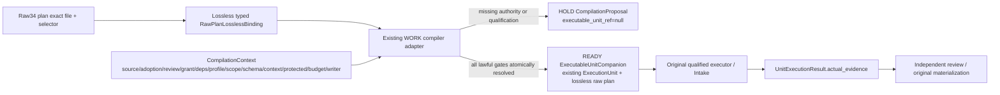

# Raw34 lossless／operation producer closure — candidate.5

Subject：`MA-ARCH-REVIEW-v5-CYCLE01`。作者設計修正；所有 unit 尚未獲得施工授權、結果資格或正式 acceptance。既有 WORK Compiler、Result Intake、Resume、R06 Context／Trusted Reading 與原 domain handlers 保持唯一責任人。本 companion 未經合法採納與既有 extension 能力 qualification 時為 `UNSUPPORTED/HOLD`。

## 完整 Raw → Typed → 原閉合系統 adapter

實際 candidate.4 source：raw plan schema required=34 欄；`ExecutionUnitPlanArtifact` 舊 typed model=20 欄；`ExecutionUnit` 舊 compiled companion=19 欄。兩個 model 不能互相隱式 cast。candidate.5 的 raw counterpart 必保存全部 34 欄，而 compiled DTO 繼續使用原有責任、額度、STOP 與 evidence 語意。

`RawPlanLosslessBinding` 必含 exact plan/file refs、JSON pointer、完整 raw body、file raw-byte SHA256、selected-body canonical JSON SHA256、exact schema ref。raw file hash 與 canonical selected-body hash 是兩種 hash domain，不能互相代用。從 exact raw source解析為 typed再輸出 raw object，必逐欄相等；required 欄缺失、未知欄、enum/schema disagreement 一律 `INVALID_DESIGN_INPUT`。不以 prose、schema label或 fixture 補缺欄。

| Raw 欄位群 | 保存／交換規則 |
|---|---|
| unit/feature/alias／plan revision/predecessor/hash | 永久 IDs、別名不變；plan successor append-only；前身 raw content／hash domain 保留。executor 更換不重設 identity／credit。 |
| chapter/source／requirement revisions | exact final candidate.5 source/章節/schema/body subject；observed master 與 future main 分欄；每個 requirement exact revision由 Registry successor綁定。 |
| deps | raw欄位保存；`UnitDependencyQualification` versioned companion另綁 consumer mode、expected output model、qualified result或scoped reuse proof、schema/env/cut適用性。 |
| allowed/protected/interface | planning allowlist不等grant；原 WORK 解 exact placement/base blob/CreateNew；protected source是 exact blob/current applicability/reading receipt組合；interface中每 operation有producer、型別、case refs。 |
| IO/tests/evidence | 主／副 IO分別具名；所有正負競態 fixture與schema/model相同 subject；required evidence是需求，actual evidence只來自後續合法 executor producer。 |
| migration/risk/capability/cost/STOP | 原語意完整保留；六因素cohort/tool writer qualification缺項HOLD；actual成本沒有資料則null+reason；不把fixture成本當實測。 |
| cohesion/goal/authority/implementation/schema/compiler/readiness/verification | 保存為 raw body的一部分，不能因typed compiled DTO較窄而丟棄；九狀態軸獨立。 |

`CompilationContext` 明列 adopted source、exact review、active grant、每個producer result/reuse資格、protected exact blob/current applicability、executor/tool qualified cohort、schema closure、TrustedContextReceipt、exact scope/base blobs、current authority、budget與writer generation。沒有grant或adoption不是無效設計，可產 `CompilationProposal` 指明缺項；不能配發execution／invocation／writer claim。source/schema/body不合法則先拒絕設計，不掩蓋為authority pending。

`UnitCompileOutcome.kind=HOLD` 的 body 僅 `CompilationProposal`，`executable_unit_ref=null`；`READY` 的 body 僅 `ExecutableUnitCompanion`，保存原 compiled `ExecutionUnit`、完整 raw plan與全部exact gate receipt refs。原 closed package/execution/claim/invocation/result schema不直接增欄。adapter只能使用既有extension slot，若無合法 slot需要授權 successor；不能另外建 compiler／controller。

atomic bind前重新驗 grant currentness、writer generation、scope、protected來源、context／dependency適用性。校驗後grant consumed或generation變更，返回HOLD，沒有READY receipt。相同idempotency key與完整 compilation input digest重播同receipt；同key異digest為conflict。

## Operation／consumer mode與同世界依賴

`OPERATION_PRODUCER_CONSUMER_MAP.candidate.v5.json` 對全部95 operations指定唯一 usecase producer；UI頁面的operation consumer透過原19頁actions辨識。不能把某章所有API逐一貼到章內每個unit冒稱都已實作。原 owner使用案例producer、UI整合consumer、transport/schema設計checker、純domain模型unit分開：

- `IMPLEMENT_OWNER_USECASE`：具名request→response、原 owner writer/UoW與完整正負競態oracle；可依法使用exact scoped reuse adapter。
- `IMPLEMENTATION_INTEGRATION`：每個實際使用operation／journey要求對應producer qualified immutable result或scoped reuse proof；schema存在、source hash可讀、author fixture不是滿足。
- `DESIGN_CHECK_SOURCE`：只驗exact schema／wire／cardinality／body／compatibility source；不把每個runtime producer都變成設計前置，也不宣稱產品整合已完成。
- `IMPLEMENT_DOMAIN_MODEL`：保留既有primary domain DTO/算法責任；沒有新的physical API producer宣稱，相關 source/read interfaces以明列dependencies/reuse解綁。

dependency資格須同source revision、schema/model revision、profile、environment、account/cut用途與consumer acceptance scope；result body/type不符、qualification scope不含operation、source drift或unknown applicability皆HOLD。DAG依dependency unit永久ID及exactplan revision判循環，operation/result邊不以名称清單替代。

MA10-U01是共用transport/schema設計checker；MA10-U02–U05實際各頁consumer依具名domainproducer；MA10-U06整合上述consumer outputs與stream/cold-reentry。不以共用layout completion冒稱95 endpoint成功。MA15-U02是設計compatibility checker；MA15-U03是原六journey qualifiedproducer/result整合。

## Bodyreadback與未知結果

Root必合入另一作者的同版 Body Catalog／immutable BodyBinding／BodyReadback。getGraphDraft/getRegistry versioned inline/resolver read、getOperation cold exact result body必是ref/model/schema/hash-qualified。POST仍返回正式OperationReceipt，result_ref只在原owner body capture/verify後掛上；UI確認前從server讀exact bound body。原getArtifactBytes是binary stream，不能當任意domainref JSON decoder。

body capture_success、SQLIndexed、A/B backup_success是不同proof。body capture verified但SQL index失敗，不可偽稱body未capture；有ref卻body MISSING/CORRUPT/UNKNOWN/CONFLICT不能跳過readback以舊browsercache確認。immutablebody的exacthash與scope/privacy仍由原owner／readerpolicy決定，不新truth engine。

## 具名 consumer閉包

- MA08-U03：PAPER `STANDARD` admitted Deployment→SimulationSession；start/get/pause/resume/replay各有typedrequest／response與frontier/CAS。pause frontier12與event13競態拒stale；resume要求exactpause receipt、same snapshot/config/profile並fresh lawfulgate；replay產新session並保原session，LAB counters與LIVE I/O不動。MA08-U06消費這個producer的exactqualifiedresult/reuse。
- MA14-U01：完整RawPlanLosslessBinding＋CompilationContext→UnitCompileOutcome；missinggrant、lossyverification欄與grantdrift反例不配置execution。
- MA14-U04：UnitResultIntakeRequest→UnitResultIntakeReceipt與UnitResumeRequest→UnitResumeReceipt。actual result所有欄明列、invocation/profile/source/diff/test producer一致；durable intake不是reviewacceptance。舊writer仍active則拒executor switch／freshinvocation。
- MA14-U05：ContextAssemblyRequest→TrustedContextReceipt；原R06 131072-byte gate、OpenAPI security/examples/links/callbacks與UNKNOWN保護。context oversize／coverage unknown不能刪語意縮小通過。
- MA14-U06：EngineeringStatusProjection＋PlanningAssumptions→PlanningCandidate；projection消費原WORK/source/cost/lifecycle/context，冷啟動讀exactbody。timer／planning均不dispatch。
- MA16-U03：MigrationRevision→MigrationPlanCheckReceipt，source/target/precondition/forward/backfill/rollback/coverage具名；actual_sql_execution=false。
- MA16-U04–U06：原health/auditprojection、Storage/K/J/H/Auth handlers、BackupSetManifest/RestoreReport/GitRebuildPlan outputs/reuse明列。verifiedcontent不等currentgrant/readiness；新epoch使舊lease失效，missingprivate或partialcut保RecoveryHold。

## 原定六旅程

| ID | 原旅程／完整typed鏈 |
|---|---|
| J1 | Source→Snapshot：raw/license/calendar/coverage/causal dataset；latecorrection、wrongtimezone、無positiveemptyproof。 |
| J2 | Builder→Research→Comparison：AST/archive preview、graph/body/branch/code/snapshot/method/run、finite Analyst研究clone、six display/unlimitedhistory；no lookahead或hotload。 |
| J3 | ManualRelease→PAPER：exact Human subject→LibraryRelease→admission/config/profile→STANDARDsession lifecycle；draft／subject drift／envleak拒。 |
| J4 | Decision→Order→Fill→Capital：wholeaccountbudget、OriginBinding、DecisionCut、Reservation、FinalWitness、durable OrderAttempt、Fill/Economics UoW；unknownack不重送、duplicatefill不重計。 |
| J5 | Disconnect/Restore→FreshReentry：complete queries／BackupCut／requiredprivate／RestoreReport／new epoch/currentgate；empty≠FLAT、verifiedrestore≠READY。 |
| J6 | Requirement→Unit→Evidence→Registry：freshrequirementrevision／exactplan／compileHOLD-orREADY／actualIntake／independentreview/adoption／publication/projection；717edges不doublecredit。 |

每journey有獨立initialworld、typedinputmodels、producerdependencies、wirecase refs、順序steps與具體正負競態expectedvalues，禁止一段combined B3scenario代表六旅程。

## 作者驗證與Root finalization

作者只執行JSON/source／DTOshape／fixturecounterexample／候選DAG檢查。模型例的syntheticadoption/grant/result refs只屬fixture world，不能送原WORK／Git／SQL／runtime。獨立review、formaladoption、原compiler/intakeprofile、實際PostgreSQL兩connection/crash、PAPER/Broker、Windows capture/restore與release qualification皆未執行。

Root順序合併Registry revision與Body/APIdelta後，生成chapter/source/model/schema/unit/fixture exactcandidate.5 bytes；更新rawschemas所有revision/path/selector規則；重新計算planuuid／dependencyuuid／modelsemantic／rawsha／companionbindings。fragment的ROOT_FINALIZE符號只可存在作者片段，不可留在frozenexactsubject。保護原永久ID／Feature、既有acceptedblobs與原STOP，不為固定96勉強增加unit。
