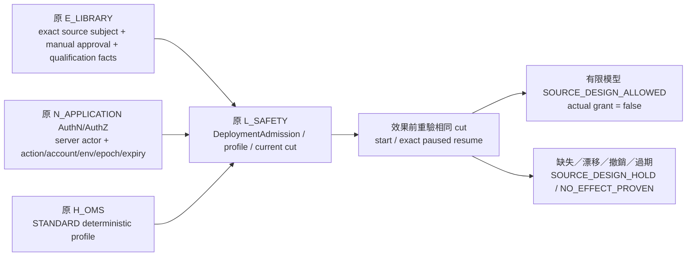

# PAPER positive source closure／UI consumer companion — candidate.7

Subject：`MA-ARCH-REVIEW-v7-CYCLE03`。作者身分為 bounded Architecture Owner helper。所有世界、receipt、approved 狀態、qualification facts、permission 與 expected outputs 均為 `SYNTHETIC_SOURCE_DESIGN`／`SOURCE_DESIGN_NOT_GRANTED`；原 WORK、RuntimeAdmission、AuthN/AuthZ、Result Intake 不能把它們當成 operational source。Runtime、PAPER、Broker、SQL、Controller、跨語言 serializer 與 browser E2E qualification 均未執行。

## Summary

PRODUCT-V6-PAPER-POSITIVE-CLOSURE-01 的來源問題是 admission/profile 只有 ContractRef，正向 start/resume 不能重算 fresh gate。此 companion 在同一有限世界提供原 owner 的完整 typed body、immutable source origin、exact body bytes、schema closure 與 model digest；原兩個 positive wire cases 直接消費這組正文。它不宣稱產品已取得實際准入。

UI01 的 current `getDashboard` 回應統一為 `DashboardProjectionV6`，顯示資料讀取 `ReadEnvelope.data.dashboard`。`paper_catalog` 只有帶 PaperCatalogQueryV6 時才要求其正文；no-PAPER-query fixture 的 optional 值為 null。其他五頁的過度廣泛 `unit_consumers` 依既有 operation map 的具名 responsibility 對齊；全部十九頁的 secondary reader tokens 亦對齊 `MA-DTO-v6`。沒有新增 operation、頁面、Unit、Feature、truth owner 或 acceptance owner。

## Analysis

原 `08_OMS_PAPER_LIVE.md` 的 RuntimeAdmission 必須固定 release、config、engine、schema、rules、risk policy、account/group/environment、capability、qualification 與 authority revision；LibraryApproval 與 RuntimeAdmission 是不同責任。原 candidate.5 MA08-U03 指定 resume 需要 exact pause receipt、same snapshot/config/profile 及 fresh lawful gate。本件只補齊這些已存在的來源欄位與 applicability，沒有更改 accepted recovery semantics。

`PaperExecutionProfileV7` 明列 `STANDARD`、deterministic provider、implementation/engine/schema/rules/risk refs、permitted actions、`broker_network=false` 與 `credential_access=false`。每個被檢查的 component 都有有限 `PaperSourceFactV7` 正文；PAPER profile 不等於 Shioaji vendor paper qualification。

`PaperLibrarySubjectV7` 先固定 exact release entity/revision、strategy/snapshot/config/profile。原 E_LIBRARY 的 `PaperLibraryApprovalV7` 與兩份 `PaperQualificationV7` 讀取這個 subject；最後的原型別 `LibraryRelease` 保留其 closed fields，state=APPROVED、approval_kind=NORMAL_QUALIFIED 只屬合成世界。批准 receipt 與 release ID、strategy、snapshot、qualification list 必逐項相等。實際 Human approval、STANDARD simulation 門檻及 qualification 必由後續原 owner 適用政策決定；這裡的有限示例政策不是對 repository 未採納 threshold 的補決策。

`PaperQualificationV7.observations` 只保存 immutable evidence_ref 與 evidence_key。來源模型從實際 facts 讀值，再對 `PaperAdmissionPolicyV7.required_checks` 重算；沒有單一 `qualified=true` 或僅 names/hashes 的 positive oracle。它明示 SOURCE_DESIGN_PASS，不能轉成 qualified Unit result。

`PaperPermissionV7` 是原 server AuthN/AuthZ 的 resource/action slice，不是新增 grant owner。它包含 authenticated actor、exact project/account/PAPER scope、deployment entity、allowed actions、admission epoch、permission epoch、valid_from、expires_at 與 revoked。`PaperGateContextV7` 來自 server，不能由 client request、role label、UI button 或 browser cache 發明。

`PaperAdmissionReceiptV7` 固定 deployment entity/revision、release/config/profile/policy、complete qualification list、authority revision、epoch、permission epoch 及有效區間。`PaperCurrentCutV7` 固定同一組 exact refs 與 owner generation、session/frontier、completeness；兩者必逐項相等。效果前 current cut 若和 gate 時不同即 HOLD；timestamp 只檢 expiry，epoch/generation/frontier 才決定 applicability。

start 要求 PAPER、ADMITTED exact Deployment、approved exact LibraryRelease、相等 config/profile、完整 qualification 與 permission/current cut。resume 再要求 PAUSED exact session、exact SUCCEEDED pause result、frontier=12、same snapshot/config/deployment/profile。缺來源、UNKNOWN cut、資格列表不同或原 receipt 不適用時皆停止，不從 restored/local validity 推進 trading readiness。

## 可施工的原 owner operational read contract

`PaperAdmissionReceiptV7`、`PaperLibraryApprovalV7`、`PaperQualificationV7` 三種含 SOURCE_DESIGN_* 狀態的型別是 **MODEL_VECTOR_COMPANION**，沒有 operational enum mapping或runtime parser。其他 stateless source facets 與下列 read view 是具名 `ORIGINAL_OWNER_VERSIONED_READ_VIEW_CANDIDATE`；它們只定義原 owner 的來源讀取資料，不配置 authorization／acceptance／execution。

| 原 owner adapter | 完整 typed return／固定比對 |
|---|---|
| L_SAFETY `read_profile_exact(source_profile_ref, required_cut_ref, server_scope)` | `PaperOperationalProfileReadV7`：明示 source_profile_ref、STANDARD provider、config、implementation/engine/schema/rules/risk refs、permitted actions、network/credential boundary；ref 是 captured view身份，source_profile_ref才是原 profile subject。 |
| L_SAFETY／N_APPLICATION `read_admission_exact(source_admission_ref, required_cut_ref, server_context)` | `PaperOperationalAdmissionReadV7`：scope、source_admission_ref、完整 Deployment、LibraryRelease、operational profile、config、policy、permission/current cut、manual approval、每個 qualification binding及原 authorization。source_admission_ref必等原 Deployment.admission_receipt_ref與current cut。 |
| 原 E_LIBRARY qualification／manual read | `PaperOperationalQualificationBindingV7` 與 `PaperOperationalLibraryApprovalReadV7`：明列 source_qualification_ref/source_approval_ref、exact subject/policy/profile/evidence與authorization；來源refs必等LibraryRelease/current cut集合。沒有新增QUALIFIED或APPROVED enum。 |
| 原 N/L authorization provider | `ProtectedActionAuthorizationReadV7` 是原 accepted `ProtectedActionAuthorization` 的 thirteen-field lossless read mirror；provider與gate仍由原 accepted source實作。 |

原 authorization source 固定於 accepted runtime commit `e4e238ccc3edb753c86e89368efe0645d6337f58`，`trading/authorization.py` Git blob `35d4edeb77703d022d6c1e46def9e96d3d4823e3`。它的 closed decisions仍只有 APPROVED/DENIED，authority environment仍只有 TEST/PRODUCTION。PAPER是ResourceScope的execution environment，不能把PAPER字串自動轉TEST或PRODUCTION。action依原規則uppercase、IDs normalize、時間aware UTC；本件不變更其constructor或gate。

adapter必以原 `ProtectedActionAuthorizationProvider.verify` 與 `require_protected_action_authorization` 比對authorization ID、trusted environment、action、resource、protected world fingerprint、command ID與correlation ID。APPROVED只證明exact protected action/world授權，原檔明文說它不是IAM、business/currentness或Broker grant。原N_APPLICATION仍檢authenticated actor與resource/action/account/PAPER scope、permission epoch/expiry/revocation；原L/E domain gates仍檢LibraryRelease.APPROVED＋NORMAL_QUALIFIED、Deployment.ADMITTED/RUNNING/PAUSED、complete policy/evidence、config/profile相等與效果前complete current cut。admission view只服務session lifecycle；後續financial entry仍要求原R01 DecisionCut／FinalWitness與其他accepted gates，不能由view取代。

parser規格是具名MODEL/TYPE/BODY schema的closed解碼、exact source-origin/body/schema/hash/scope比對、原owner來源與original enum比對。未知欄位、MODEL_VECTOR state、synthetic hash domain/provenance、未採納schema、未qualified來源producer、provider缺失／環境不可信／DENIED／exact-world不等、domain qualification或current cut不適用，皆HOLD／DENY；Coding不得自行挑一個real enum或用型別存在性授權。這些source read DTO不是新的physical API，也不傳raw permission/provider正文到browser。

`OPERATIONAL_READ_CONTRACT.candidate.v7.json` 包含兩個完整constructed operational read bodies。canonical狀態直接使用原ADMITTED／APPROVED／AuthorizationDecision.APPROVED；qualification/manual read沒有MODEL_VECTOR state欄位。這是獨立构造的合成原owner資料，不是把SOURCE_DESIGN_*轉成正式狀態。outside-world authority仍SOURCE_DESIGN_NOT_GRANTED，provenance明示synthetic、authorization environment=TEST、actual provider=NONE，故真正原gate必DENY_PROVIDER_UNAVAILABLE。原ownerread adapter／schema採納、producer/provider／serializer及實際資格未取得，是正常的 **ImplementationGate**，本件沒有假裝取得qualification，也没有留待Coding猜測的state vocabulary／DTO欄位。

## Actual bytes／hash 與避免 cycle

`PRODUCT_SOURCE_BODY_VALUE_CATALOG.candidate.v7.json` 的每個 entry 提供 body `relative_path`、完整 payload、raw-byte SHA256、canonical body SHA256、source origin path/hash、schema_ref 與 model semantic hash。原始 source hash、body bytes hash、model hash三軸不同，遵守 BODY_HASH_RULES_V5；model semantic 僅排除 body root ref.source_hash。

所有被補的 fixture entity IDs 沿用原值，revision append successor；原 C2 body/ref 世界仍保持 immutable compatibility。Source origin 固定 original owner、entity/revision 與來源內容。pause receipt 的 source origin 是先配置的 original operation/result 身份記錄，result 的 entity/revision 不依 body hash生成；外部 binding manifest 再固定 complete pause receipt 與 paused session bytes。這使 receipt.result_ref 精確等於 paused session.ref，同時避免 session↔receipt body hash cycle。這種 mapping 不表示實際交易 receipt 已產生。

## Alternatives

只加入更多 ContractRef、shape checks 或 `expected_success=true` 無法閉合原反例。實際執行 PAPER 或發新 Human grant 超出這次 source design scope。這次選擇有限的原 owner source world，讓 reviewer 可以直接重讀每一個被使用的 body 並自行重算原 gate。

UI wrapper 可選另建解包 adapter；本件使用 API 已存在的 `DashboardProjectionV6.dashboard` 顯示路徑，保留 immutable DashboardProjection compatibility，避免引入另一個 profile 或 endpoint。

## Risks

SOURCE_DESIGN_ALLOWED 只證明有限 as-if gate 的來源值相容；沒有實際 authentication、authorization、signature、clock、atomic effect boundary 或 qualification。MODEL_ONLY 的 seed replay／no-I/O facts 不是實際 runtime tests；不可用本文推導 production readiness、PAPER grant 或 formal completion。

把新 profile/admission successor ref 插入 cold catalog 後，其 filter digest、source receipt query digest、snapshot/cursor、body catalog與各 producer/consumer hashes 必重新計算。保留舊 profile hash配新 body會造成 immutable conflict；只改文件 labels 不構成 closure。

## Recommendation／Root integration

1. upsert `models_upsert.json`、`types_upsert.json` 與 `body_catalog_upsert.json`，保持既有 LibraryRelease、Deployment、SimulationSession、OperationReceipt closed fields原樣。
2. 將 actual `fixtures/product-v7` bytes、有限 world、source body value catalog 與 Addendum 一起納入 candidate。world 的 body catalog 指向 final `PRODUCT_SOURCE_BODY_VALUE_CATALOG.candidate.v7.json`。
3. 以 `wire_cases_upsert.json` 替換原 C6 start/resume positive case rows，保留永久 case/operation IDs。它們的 request、receipt、session、initial gate inputs均已具體化；重新產 request/response/value catalog與 current operation coverage links。
4. 依 `ref_replacements.json` 的 exact old entity+revision映射更新 current cold discovery／PAPER fixture consumers；不以名称尋找 ref，也不改 historical compatibility。重新計算 query/cursor/store receipt/filter及 affected bytes。
5. 合入 `UI_PAGE_CONTRACTS.json`。getDashboard 顯示 path 明示 wrapper；所有 primary/secondary request/response/cardinality/profile一致。移除未具名 responsibility 的 blanket consumer，不替它們憑空增設 qualified dependency或producer。
6. Root 完成所有片段後統一重新生成 final schema/body/model/API/Unit/source/interface/test hash bindings、fresh successor plan revisions。作者 stage schema refs不能取代 final合併 schema。
7. fresh independent review 仍是必經門檻；任何原 accepted semantics conflict 停止受影響項目，不推進 execution。

## References／作者檢核

- C2固定產品 findings：PRODUCT-V6-PAPER-POSITIVE-CLOSURE-01、PRODUCT-V6-UI01-DASHBOARD-WIRE-02。
- C2固定 units 19_UI_MATRIX：UI01、UI04、UI08、UI14、UI15、UI18 之十一項 primary consumer conflicts。
- 唯一active C2 final consolidated review manifest：`e9e4046b8a2f73228cc70d38a9777a73093e1462b75b75ded1bf4c8d3be8f88b`，57 outputs，active `INPUT_FIXED_REVIEW.v2.json`。曾讀interim的warning保留於`INTERIM_BINDING_WARNING.audit.json`；舊review／aggregate未回寫。
- 原契約：08_OMS_PAPER_LIVE、10_WEB_UI_API、BODY_CAPTURE_READBACK_CONTRACTS、EXECUTION_UNIT_COMPILER_ADAPTER_ADDENDUM.candidate.v5。
- 作者 `product_gate_model.py`：86 body/origin/model/closed-shape驗證；26 gate vectors，其中2 allowed、24 HOLD；兩個canonical operational read constructors及原closed-state/property mapping一致，actual provider缺失DENY；十九頁source mirrors與UI01 no-PAPER-query decoder一致。這是AUTHOR_SOURCE_MODEL_ONLY，不是獨立審查PASS。
- R01/R03/R04/R05/R07 exact accepted scope不變；R02/R06/R08未qualified，P00仍0/8；完整B3、16章／19頁／95 operations／96 Units與永久IDs保留；target main migration未執行，CODEX Sol6.1 High primary保留。
