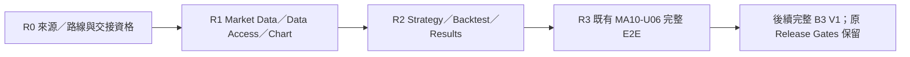

# B3 MVP 施工導航與架構收尾

交接識別：`ULTRA-B3-MVP-EXECUTION-HANDOFF-V1`。資料截點：2026-10-22（臺北）。本文件為 **CANDIDATE 導航附件**，不修改 Accepted Architecture、Program V2、CURRENT_STATE、Grant 或 Review Lifecycle。凍結的五份內容與來源清單由同目錄 `HANDOFF_STATUS.json` 綁定；該檔自身不列入自己的 Hash。

**收尾建議：`DESIGN_FROZEN_PENDING_EXECUTION_AUTHORITY`。** 已接受的 B3 設計保持凍結，下一步轉入受控資格及逐單施工；本輪沒有新的產品 Coding、Qualification、Review Acceptance、Git 發布或 Controller 啟用。架構與契約閉合的既有證據沿用，不重跑完整 B3。

## 目的與範圍

建立可操作的內部垂直里程碑：合成市場資料 → Canonical MarketBar 查詢與 K 棒 → 策略／合成回測 → 損益、權益與回撤 → Workspace／結果 → 端到端回歸。MVP 不刪減完整 B3 V1，不把未完成義務移至 V2。後續仍沿既有 12 Packages、96 Units、95 API、19 UI、364 條依賴及 64 筆 Historical Findings 施工。

R0～R3 只是測試及階段檢核分組，不是新 Machine State，也不是取代原有 Unit Gate 的四張通行證。K 棒畫面與回測畫面受既有 DAG 的其他治理、資本與操作契約相依限制，不能假裝只有圖中幾個 Unit。

## Source-of-Truth 核對

| 層級 | 實際來源／完整 SHA | 判定與使用限制 |
|---|---|---|
| 本機 checkout | `architecture/p00-v1-baseline`；`2634717b1443eb95fa0fde4d5d987347ef2160e8` | 目前有既存 dirty／untracked 成果；本輪保留，不做 checkout、清理或暫存 |
| GitHub master | `9b5ab5fdd98744a7db45ec9f14b64ef1f324920f` | 實際遠端 HEAD；B3 正式入口在 master 回傳 404，不得把 master 當成已包含本機 B3 |
| B3 Publication v3 | `9643bfc93a1631154be877536a1c91fc58df84be` | 公開已採納基線的發布截點；不是本機最新 Current State |
| NAV Topic HEAD | `e287f6ac0744875e8d4bca103a6b73b4cf53416d` | `codex/b3-v1-accepted-baseline-publication`；本輪唯讀核對；不等於已 merge 到 master／main |
| 本機精確採納 | `docs/architecture/adopted/B3_V1_ACCEPTED_BASELINE.v1.json`、`docs/program/decisions/B3-V1-DUAL-ADOPTION-20261015-v1.owner.v1.json` | ACCEPTED；原 Owner Receipt 與既有 Blueprint 語義保持不變 |
| 最新工程 Consumer 補充 | `b3-engineering-consumer-projection-successor-proposed-v1` 的固定候選與 Fresh Review | B-TRACE-01 `CLOSED_BY_EVIDENCE`；必須與原始來源共同使用，不能只讀舊摘要 |

已採納 Subject：`MA-ARCH-REVIEW-v9-SOURCE-CLOSURE-PAIR01`。Envelope SHA256：`ca68aec60620755c55e598f876dea01a62f7757db381019b99febdb8127d0ae3`。A Scope：`ff5fbb4b378dcb9aac91d4a0b55474a8ed9de944121593f7baa441c6f4bd1b01`；B Scope：`6a92215477e06edd2a885846264e4d1b2ecffd72866a4b2e1f8dea756f1590e6`。

公開閱讀入口：[B3 Topic](https://github.com/chunwork003/futures_trading_system/tree/e287f6ac0744875e8d4bca103a6b73b4cf53416d)、[已發布 B3 架構](https://github.com/chunwork003/futures_trading_system/blob/e287f6ac0744875e8d4bca103a6b73b4cf53416d/docs/architecture/B3_V1_ARCHITECTURE.md)、[Operating Guide](https://github.com/chunwork003/futures_trading_system/blob/e287f6ac0744875e8d4bca103a6b73b4cf53416d/docs/PROJECT_OPERATING_GUIDE.md)。公開文件中的私人磁碟路徑是來源定位資訊，不保證其他電腦可讀；依發布 Locator／Derived Index 解析，並驗證原件承載及解包後 Hash。Derived 可供導讀，不能冒充 Canonical 原文。

本次六份交接檔、B-TRACE-01 本機補充與最新 Unit Acceptance／U02 試驗證據，**未由本輪發布到 GitHub**。新 Executor 必須能讀取固定本機來源或另有合法、可讀回原文的精確 Source Assembly；缺件就 HOLD 該次使用。不可將舊 NAV 內的歷史 Coding=0 覆寫成目前授權。main 最終主線政策保留，實際遷移仍未完成；本輪不要求先 merge 所有歷史才可提出一張精確本機 WO。

| 分類 | 本輪核對後的定位 |
|---|---|
| ACCEPTED | B3／Guide 雙項採納；MA01-U01 外部正式 Accepted Result；既有 Program V2 rev5；原已接受 Blueprint／GAP08 語義 |
| DESIGN_FROZEN | B3 永久身份與原始 DAG；IR／RR／B-TRACE 已閉合範圍；不重新設計 |
| CANDIDATE | 本交接包、工程路線與檔案提案、尚待個別 WO 固定的 Mock／Golden Oracle／工具鏈 |
| NOT_AUTHORIZED | 新產品 Coding、其他 Unit Grant、Writer、Dispatch、Git、SQL／Restore／Broker／Controller 等尚未取得權限的效果 |
| MISSING_EVIDENCE | MA02-U01／LM 等實際 intended-use 資格、正式新 WO／Budget／Grant；R1 真實隔離 DB、UI build／browser／E2E 等尚未執行證據 |
| CONFLICT | 本次必要閉包未發現需重開全域 B3 的新重大矛盾。歷史狀態與規劃路徑差異依 Current Authority／精確 WO 處理，不宣稱已驗證全部未變動歷史 |

沒有 `docs/PRD.md`；需求來源沿已採納 Requirement Registry／Blueprint，不自行補造 PRD。`docs/AI_HANDOFF.md` 內歷史狀態不能覆蓋 `docs/CURRENT_STATE.md`。

## 真實 MVP 路線與最小性

`MVP_ROUTE.yaml` 逐項列出 57 個真實 Unit 的 UUID、Revision、來源正文 Hash／JSON Pointer、原上游依賴、Package、API／UI、Consumer 角色、規劃檔案、Test Oracle 與執行限制。它是完整來源的導航投影，不是另一份 Unit Registry。

選擇既有 E2E `MA10-U06` 作為本次使用者要求的操作終點，其全部祖先閉包為 **57 Units／184 條原依賴／11 個結構波次**。這是此既有目標的最小祖先集合，不是所有可能產品範圍的全域最短工時，也不是仍需新增 57 份程式。可重用成果須有精確 accepted／qualified reuse 證據。

原本單純研究 MVP `MA10-U03` 閉包只有 16／47；加入 Chart 與 Research 目標的聯集為 38／113；這些均不能替代本次要求的 MA10-U06。更廣的 `MA15-U03` 整合閉包為 69／264，仍保留其原本適用的正式整合與 Release 義務。不能用內部 MVP 宣稱 Complete B3 V1。

| 結構波次 | 原 Unit ID（同列並非同時施工） |
|---|---|
| W0 | `MA01-U01` |
| W1 | `MA01-U05`、`MA02-U01`、`MA10-U01`、`MA11-U01` |
| W2 | `MA02-U05`、`MA03-U01`、`MA06-U01`、`MA11-U02`、`MA11-U03`、`MA11-U04`、`MA12-U01` |
| W3 | `MA03-U02`、`MA03-U03`、`MA03-U04`、`MA04-U01`、`MA06-U03`、`MA06-U04`、`MA06-U05`、`MA07-U01`、`MA12-U02`、`MA12-U04`、`MA13-U01` |
| W4 | `MA04-U02`、`MA05-U01`、`MA06-U02`、`MA07-U02`、`MA07-U04`、`MA07-U05`、`MA08-U01`、`MA13-U02`、`MA13-U05`、`MA14-U01`、`MA16-U01` |
| W5 | `MA04-U03`、`MA05-U02`、`MA05-U03`、`MA05-U04`、`MA06-U06`、`MA08-U03`、`MA08-U04`、`MA09-U01`、`MA14-U02`、`MA14-U03`、`MA14-U05`、`MA16-U02` |
| W6 | `MA04-U04`、`MA14-U04`、`MA16-U04` |
| W7 | `MA04-U05`、`MA10-U02`、`MA14-U06` |
| W8 | `MA04-U06`、`MA10-U04`、`MA10-U05` |
| W9 | `MA10-U03` |
| W10 | `MA10-U06` |

以上是依賴層，不是多 Writer 或同時施工授權。不同 Worktree／Branch／工具仍共用既有全域單 Writer 限制。完整 96／364 的其餘 39 Units 不因不在本次 MVP 閉包內而失去 B3 義務。

目前 Accepted Units **1／96**，為 MA01-U01；現在的結構 Frontier 為 `MA01-U05`、`MA02-U01`、`MA10-U01`、`MA11-U01`，**Executable Frontier 為空**。推薦下一張先準備 **MA02-U01**（資料基礎），不是按編號先做 U02。這是本次 MVP 的規劃建議，不改寫 CURRENT_WORK 的既有 U02 支線或啟用新的佇列權限。U02-QF01 是 U02 專屬 HOLD，不在此 MVP DAG 中；不取消它，也不讓它無差別阻擋其他 Unit。

## Contract-First 與最少必要驗證

正式層次維持 `React → ASP.NET BFF → Python API → Quant Core → Persistence`。API Operation／DTO／Schema／Auth／Error／Retry／Producer／Consumer 只有一份正式來源，Mock 與 UI Adapter 不另創商業語義。

例：`queryMarketBars` 由 MA03-U02 擔任 Producer；GET `/api/v2/market-bars`，`ReadEnvelope`、`CanonicalMarketBarDto`、MA-DTO-v6 與 `X-MA-DTO-Version` 遵原契約。BarQuery 與外層 CursorRequest 的頁面條件需 EQUAL_OR_REJECT，衝突在作用前拒絕（422）；簽署 Cursor 綁定查詢、scope、排序、版本與到期。缺值不能填 0；PricingObservation 不能當成 OHLC K 棒。

受影響 Unit 的精確 WO 必須先解析真實 `domain.bars.Bar`／`backtest.MarketBar`／canonical observation 與 Candle DTO 的 Adapter；名稱相似不代表型別等價。ResearchRun 透過 immutable `result_refs` 讀結果，不在 UI 臨時發明 PnL 欄位。

歷史市場資料依既有 B_DATA_PIPELINE 保留 Parquet／DuckDB／Arrow，PostgreSQL 保存其正式 metadata／reference／應保存狀態。R1 必須驗證受控的真實隔離 DB／Data Access；**不能只跑 Mock 就宣布 PostgreSQL 合格，也不能為未授權 Migration 自行讀 DSN 或建 DB**。MA11-U05／MA12-U05 的工程 Registry SQL 不替代市場資料持久化。

沿用既有 BacktestEngine 與 metrics，避免重寫。K 棒時間／下一根成交／future leakage／資料 snapshot 與 cost policy 綁定；權益與回撤口徑必須在 Fixture 明示。`STAGE_GATES.yaml` 提供可綁定的合成數值 Oracle 候選，狀態 NOT_RUN；不得把純算術或測試規格當成已實作／已接受產品。

UI 根目錄在既有 O_REACT_WORKSPACE 指向 `apps/web`，Unit 另有 `web/src` 提案；兩者都不是本輪檔案授權。依 O130 先固定前端工具鏈，並在受影響 WO 指定唯一實作路徑、版本與允許檔案；不大規模移位既有專案。現有部分 test/module 路徑尚不存在，命令均為提案，必須由實際 WO 與 Case Mapping 固定。

R1／R2／R3 使用既有 Unit 全部強制案例；例如 MA10-U02 **142**、MA10-U03 **192**、MA10-U06 **428** 個必要 Case ID 不縮水。階段聚合不取代每 Unit Targeted／Negative／Regression／必要獨立 Review。64 Historical Findings 依既有 Regression Plan 的 Trigger 選擇，新增結果證據與「已有規劃」分開。

## 下一個合法工作與最小決策

**現在可做：**依本包準備 MA02-U01 的唯讀 Source／intended-use 適用性與資格差額、既有單 Unit 原生 WO／預算候選、U01 Accepted Dependency 讀回、精確 Allowlist／Test Oracle。不得執行新 Qualification、產品 Coding 或 Dispatch。

**下一個必須固定的 Human 決策：**選定 MA02-U01 的實際 Executor 路線及其限定 intended-use／Qualification Scope。承接人先依法從正式 Source 封存精確申請，列明 Operator、Source／Context／Result／Intake、23 案例等是否實際適用、資源／成本／允許副作用與停止條件；不可抄 U01／U02 的限定 Grant 或假稱本包已有新固定 Scope。若既有合格收據確實完整涵蓋，引用正式依據直接重用；本輪尚無此證據。

Qualification、適用政策與 Source／Writer／Budget 全部有效後，才提交 MA02-U01 精確 Coding Grant。不能將「本包導航獲核可」合併解讀為其 Qualification／Coding 已獲批准。若維持 U02 為獨立非 MVP 支線，既有 QF01 待核申請 Hash 為 `6ced4fbe93589ce57c11c7ecf0eeae3d24e80b4a52806d2056fe48b8f2cba3bc`；不在本輪重跑試驗或自動修復。

## 收尾與高階模型退場

G1～G6 的證據、靜態乾跑及未執行範圍見 `HANDOFF_STATUS.json`。本輪只完成導航級作者靜態核對；不是新的正式 Fresh Review／Qualification。既有 Acceptance／獨立 Review 按固定 Hash 重用。

Ultra 可退出日常拆單、Coding 與例行測試；WORK／合格 Executor 按 `VS_CODE_EXECUTOR.md`、原 Kernels 與逐單授權接續。高階 GPT 在 R1／R2／R3 完整功能階段，或實際出現受保護契約、資金安全、Source／Authority 等重大矛盾時檢核。原契約要求的每 Unit Independent Review 仍須由合格獨立 Reviewer 完成，不能因改為階段檢核而取消。

**不需要新開發自動化 Controller。** 既有 WORK／Program V2 可執行合法選單、候選編譯、Evidence 與 Intake；目前 Controller 未啟用、單次 autonomous mainline package 邊界保留。NEXT 可預備下一張，跨原授權邊界時必須停止，不把 Prompt 當 Authorization。

完整 B3 V1 Code Complete 後的 Repository 重整仍待另行授權：Inventory、舊新路徑 Mapping、protected bytes／Receipt、Rollback、Build／E2E 與獨立 Review；此時不搬檔、合併 main/master 或清理歷史。

## 六份交接檔與來源

- `MVP_SCOPE.md`：人類／新對話的第一閱讀入口。
- `MVP_ROUTE.yaml`：真實 Unit 祖先閉包、依賴、API／UI、Consumer、檔案及測試指標。
- `WORK_ORDER_CONTRACT.yaml`：原制度 Work Order 編譯檢核介面；不是另一個 schema。
- `STAGE_GATES.yaml`：R0～R3、G1～G6、風險、Regression 與 Deferred Gates。
- `VS_CODE_EXECUTOR.md`：可直接貼入新對話的手冊、讀取順序、PowerShell、停止及恢復程序。
- `HANDOFF_STATUS.json`：固定 Hash、乾跑結果、實際狀態與 Durable Checkpoint；不取代 CURRENT_STATE。

必要 Source／Revision／Hash／JSON Pointer 已置於 YAML 及狀態檔，依需求讀取其原始正文。查無必要來源應明示 MISSING_EVIDENCE，不用聊天、摘要、Hash 或其他產品的 AGENTS 技術偏好替代既有正式 B3 契約。
