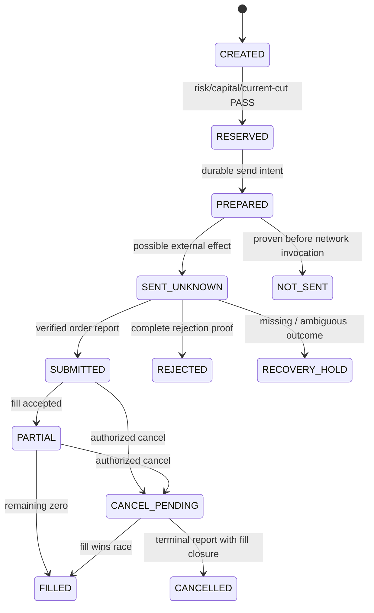

# MA08 — OMS、PAPER／LIVE 隔離、故障恢復與 Fresh Re-entry

Revision `candidate.4`；Owner H Execution OMS／J Account／K Recovery／L Safety；AUTHOR_CHECKED／FORMAL_REVIEW_PENDING。

## Purpose／Source／Reuse

沿用 H_EXECUTION_OMS、L_SIMULATION_LIVE_SAFETY、ADR-002、trading/execution.py（66b4cc6a27b50ed30ed072f2c1d99ad0895f99fd）、accepted GAP08 event/account/recovery invariants。新 v2 OMS companion 連接多資產/OriginBinding，不直接修改 closed OrderStatus／Fill constructors。LIVE 本次完整設計，但 credentials、brokerI/O、資金與真下單沒有新授權。

## Models／Ports／Inputs／Outputs

OrderIntent：永久 intentID、account/environment/group/deployment/release、instrument/listing/rule refs、side、qty/unit、price/TIF/effect、Decision/Risk refs、capitalreservation、currentcut/fence。OrderAttempt：attemptID、intentID、nativecorrelationref、sendgeneration、requesthash、sendstate、lastreceiptreference。BrokerOrderBinding 不可 silentreuse。OrderEvent／Fill 保留 broker-neutralimmutable IDs、dedupscope、sourcehash、causation、origin、time/frontier；economicapply owner MA06。

ExecutionPort：`submit(approved_intent,witness)`→SubmissionReceipt{NOT_SENT/ACCEPTED/REJECTED/UNKNOWN,current_order,immediate_fills}；`query_order(binding,query_cut)`→Observation＋completeness；`cancel(binding,expected_state)`→CancelReceipt；`amend(binding,change)`→AmendReceipt（僅 qualifiedcapability）；`query_fills(scope,cursor)`→immutable fills/coverage；`observe_account`→broker actual，非 expectedposition。New companion holding UNKNOWN 等狀態不混入既有 closed enum。

## Environment／Admission

LAB researchworkers 只有 sandbox/datasets、無 brokercredentials/operationalwrite；PAPER 正式 LibraryRelease＋admittedconfig，使用 STANDARD deterministicbroker，與 LABrun 資料/IDs/capital 隔離；LIVE 獨立 process/service identity、storageaccountscope、secretprovider、networkegresspolicy、explicitHuman grant。PAPERsimulation 標準不等於 Shioaji vendor simulation 資格。

RuntimeAdmission 固定 release/config/engine/schema/rules/riskpolicy/account/group/environment/brokercapability/qualificationreceipt/authority revision；config 或策略改版要 newadmission，不能 drafthotreload。LIVE gate 包括 sourcecodeexactreview、functional/integration/assetconformance、actualPostgreSQL/Recovery、brokerconnectivity/limits/unknownoutcome、paper/回放/safecontrols、完整 reconciliation、Humanriskcapital 決策及 freshgrant。未完成任何 required gate DENIED。

## State Machine／Business Rules

SENT_UNKNOWN 不是無單，networktimeout 不可再用 newintent 盲送。送單：先 durablesendintent＋reservation，freshwitness/fence 驗證→adaptercall→durableresult/event；crosssystematomicity 不可假設。Crash beforecall 可 PROVEN_NOT_SENT 需 invocationboundaryevidence；afterpossiblecall 一律 UNKNOWN，查 externalorder/fills＋exactcorrelation。broker 無完整 lookup 能力，Human 處理/維持 hold，不能自動重送。

Fillquantity 不超原 order，cumulative/individualdeal 不能雙記；Cancel 與 partialfill 共存，terminalcancel 不丟已 Fill。broker 報 terminal 但 canonical terminal 尚未接受／封存時，晚到可信 Fill 仍按原 accepted evidence transition 處理。**一旦 canonical FILLED/CANCELLED/REJECTED 已接受，terminal economics SEALED**；完整權威矛盾為 INTEGRITY_CONFLICT，不可追加 economic effect、回退狀態或捏造 recovery。證據不足為 RECONSTRUCTION_INCOMPLETE。晚到原始 bytes 必保存並 reconciliation/HOLD；改變封存語義須原 Owner 新決策，不能由本候選擴權。這保留 ADR-002 R-04F exact accepted 邊界。Modifyquantity 僅允許 qualified 減量；repricing 仍需新 RiskDecision／資金檢查，舊 reservation 不代表新價格已被授權。increase/newreplacement 需 newapprovedintent 與 reservation，notassumedatomiccancelreplace。

Exit→可信 FLAT→re-evaluate→enter；各 group lot/effect 驗證、不得借他 group 庫存。Multilegportfolio 含 legIDs/actiondependencies/capitalrisk/partialfailurepolicy，無保證 all-or-nothing；defaultstopadditionalentries、保留 filledlegs/re-evaluate，Humanqualifiedhedgepolicy 才可處理；不得自動發明追價／反向單。

## Reconnect／Reconciliation／Kill／Recovery

Connection DOWN/DEGRADED 阻止 newentries，callbacks/spool 持續安全保存可用資料；reconnect→sessionauth→contractmappingversioncheck→orders/fills/positions/cash/margin 完整 queries→J reconciliationcases→currentRecoveryCut/strategy/configmembership 驗證→newepochHumanre-entry（依原 policy 精確 gate）。connectionUP 不等 READY。

KillSwitch 只依 explicitcontrolpolicy 執行 blocknew/cancelqualifiedpending；cancelunknown 保留資源；reduce/liquidate 需 risk/capability/account/permissions。不能 kill 自動 marketflatten 所有資產。Restore/hostrestart 後 RecoveryHold，舊 leases/dispatch/reservations/authority 不自動 fresh；epoch/fence 換新、externalobservationscurrent、expectedstatevalid 才逐 gate 準入。LOCAL_VALID≠BROKER_CURRENT≠TRADING_READY。

## API／Events／UI／Security／Compatibility

API `/api/v2/order-intents`、`/orders/{id}`、`/orders/{id}/cancel`、`/reconciliation-cases`、`/recovery-status`；write 必 authenticated/resourceaccount/envscope/commandhash/expectedgeneration。一般 UI 不持有 directBrokerPort；所有 command 走 ASP.NETapplication→Pythonusecase→G/H/I/J/K。Events SendIntentPrepared、SubmissionOutcomeObserved、OrderEventAccepted、FillEconomicsCommitted、ReconciliationRunRecorded、RecoveryHoldEntered、FreshAdmissionGranted；untrustedfeed 與 trustedacceptedreceipt 隔離。

Timeout 回202/UNKNOWNoperationreceipt 而非 HTTP500=沒交易；UIqueryreceipt 不能重點產生新 command。Private raw SDK payload/store 不進 publiclogs/Git；fullcontrolaudit 含 actor/policy/ref 而非 secrets。Legacy PaperBroker 可作 fixtures，不宣稱 multicurrency/group/liveconformance；adapter 證明 subset 才 exportv1DTO。

## Examples／Acceptance／Test Strategy／Handoff

正：broker 收到但 acklost，query 同 correlation 找到 order 後 noresend；cancel 與 finalfillrace 保留 both；DBrestore 後 hold。反：terminalorder 刪 dedup、retrynewIDdoubletrade、空 positionquery 當 FLAT、brokerUP 直接 autoresume、LABrelease 自動 LIVE、fallbackexecutor 共享 tradingcredentials。

Acceptance：每外部 effectboundary 可追蹤、unknown 有 safehold、不丟 fill/資源、admission/environment 不可繞、完整 cut/reentry、acceptedcore 不變。Tests：stateproperty/randomsequence、duplicate/differingeventhash、partial/cancelamend/latefills、crashbefore/after/sendcommit、networkackloss/reconnectreorder、DBreceiptsloss、leasefence/oldgrant、groupinventory/multilegfail、kill/risk/authorizationnegative。

WORK：legacycompanion 與 sendjournal、OMSstate/dedup、STANDARDpaper、reconcile/reentry、kill/control、API/UI；qualifyfakeprotocol、actualdisposableSQL/crash、vendorpaper 與 liveconnectivity 各自分級。Knownlimits：truebroker 冪等/lookupcompleteness 及每 assetpermission 未 qualified；不從 fakePASS 外推 LIVE。

## 本次有界補充契約

[ECONOMIC_RESOURCE_CONTRACTS.md](ECONOMIC_RESOURCE_CONTRACTS.md)、[MONEY_SUBMISSION_CUT_PROTOCOL.md](MONEY_SUBMISSION_CUT_PROTOCOL.md) 為本章不可省略的候選 companion；typed resource/obligation、T12 witness、export adapter 與 exact dependency/source bindings 必隨章節 subject 一起編譯及審核。原 accepted predecessor 不變。

## RCG04 candidate.4 mandatory consumer closure

[TRADING_CAPITAL_UI_ADDENDUM.md](TRADING_CAPITAL_UI_ADDENDUM.md)與MODEL/TYPE/API/EVENT同版為本章不可省略契約；external EconomicOrigin、全帳戶budget preview/confirm、PAPER SimulationSession、MarketBar DTO、servercold-reentry/error/cursor/stream及consumer映射隨exactsubject一起審核。原accepted語義不變，Runtime NOT_RUN。

## Candidate.5 有界修正承接

PAPER start/get/pause/resume/replay的完整Unit producer、secondary IO、frontier與oracles；STANDARD研究、PAPER、LIVE權限維持分離，R01 accepted核心不改。

唯一詳細契約：`EXECUTION_UNIT_COMPILER_ADAPTER_ADDENDUM.candidate.v5.md`。原已接受範圍與尚未完成qualification保留。
