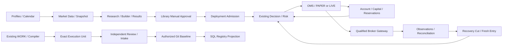

# MA15 — 跨章節 Integration、客觀資格與獨立審查 Subject

Revision `candidate.4`；Owner existing Domain Owners／Independent Reviewer／Human；AUTHOR_CHECKED／FORMAL_REVIEW_PENDING。

## Purpose／Source／Reuse

沿用 CONNECTION_MATRIX、STATE_AUTHORITY、TRACEABILITY、R05／R06／R08／ReviewIntake。候選完整設計先完成，獨立 review 與 formaladoption 再 coding；必要 runtimequal 在實施后取得，不能要求未實施 restore 先讓 P00 設計永遠卡住。不是 newAcceptanceEngine。

## Integration Contract／Data Flow

CrosschapterContractcatalog 逐條 owner/producer/consumer/schema/hash/error/qualification。Entity refs requiredimmutableversions；dataset/hash→featuregraph/code/snapshot→researchrun/result→manualrelease→deployment/config→strategyintent/DecisionCut→Risk/Reservation→Order/Fill→economicaccount/virtualorigin→RecoveryCut 是一條完整 trace。URMS 記錄工程對象，不能接管產品 moneytruth。

## Compatibility／Impact／Model

ContractRevision 有 semver/profile/schemahash/source/direction/requiredfields/precision。Closedv1 保持，newtypedcompanion/adapter 需 roundtrip/unsupportedproof；只明示兼容 subset，未支持 asset/env failclosed。Eventreplayproduceridentity/schema/profile 與 timesequence 固定；改變 chaptercontracts 需 MA12impactclosure、新 currentapplicability，不追溯銷毀舊 Evidence。ExecutionUnit 依 chapterexacthash、sourceGitSHA、gatesnapshot，latechapterrevision 僅 affectedunits 需 recompile。

三個狀態軸：design（Drafted/AuthorChecked/IndependentReviewed/OwnerAccepted）、implementation（NotImplemented/Candidate/Reviewed/Accepted）、runtime/release（NotQualified/Qualified/Admitted/ReleaseReady）。MasterIndex/ReviewReport 不能合並為一 boolcomplete。Evidencelevel SOURCE_REVIEW、MODEL_SIMULATION、ISOLATED_RUNTIME、PROVIDER_SIMULATION、BROKER_READ_ONLY、AUTHORIZED_LIVE 不同，不可互相代稱 PASS。

## Gate Classification／Dependencies

| Gate | Exact blocker／資格 | 不能擴成 |
|---|---|---|
| P00_DESIGN_CLOSURE_BLOCKER | R02/R06 原 coverage/qualification/contextsuccessor、R08original91rows/A–Sdisposition、C3→C5→C6exactreview/adoption | 不能拿新 URMS 設計繞 originalgate |
| SCOPE_AND_PACKAGE_ADOPTION_BLOCKER | 新多資產/LAB/URMSsourceboundDelta/release/denominator/Registry 契約採納 | 不自動重開 acceptedR01/3/4/5/7、GAP08 |
| IMPLEMENTATION_QUALIFICATION_GATE | actualPostgreSQL FK/CAS/write-skew/crash、Git/SQLunknown、Windowspath/capture、A/Bfullrestore、LMwriter/Controller/SDKintegration | 不是全部 P00 設計前置 runtime |
| RELEASE_OR_FUTURE_GATE | 完整六 journeys、各 asset/method/livecapability、Humanrisk/livemoney、NAS/Cloud/PITR | NAS 不阻 V1，S14/S15Future 不阻主線 |

designfreeze 新增 coresemanticsblocking：productworkidentity/financialidentity、typedcodes/dualgraph/weight、exactreview/publicationunknown、criticalcapture/samecut/freshreentry、grouporigin/capital/OMSunknown、LMexecutorprofile 一致性。本文已提出候選 contract，**是否充分由獨立 exactsubject review 判斷**，不是作者關閉原40findings。

## 六旅程／正反例矩陣

| Journey | 必須連接／positive | Negative/concurrency／Gate |
|---|---|---|
| J1 Source→Snapshot | source/license/profile/calendar/coverage→immutableDataset | wrongtimezone/latecorrection/emptywithoutproof；dataqualification |
| J2 Builder→Research→Comparison | graph/features/code/snapshot/run/method/results＋六 slots/unlimitedhistory | lookahead/unsupportedport/corruptsource/incomparablemetrics；researchqualification |
| J3 ManualRelease→PAPER | exactmanualrelease/admission/config/group→STANDARDsim | Drafthotreload/approvalsubjectchanged/environmentleak；library/runtimegates |
| J4 Decision→Order→Fill→Capital | immutableOriginBinding/reserve/finalwitness/broker-events/economicUoW | oppositegroups/internalmatch/overreserve/duplicateFill/unknownack；moneyruntimequal |
| J5 Disconnect/Restore→FreshReentry | durablejournal/completequeries/RecoveryCut/epoch/currentgrant | emptyposition→FLAT/oldlease/autoREADY/partialartifact；recoveryqual |
| J6 Requirement→Unit→Evidence→Registry | source/feature/phase/task/spec/WO/result/review/adoption/projection/weights | 717edgesdoublecount/accepted=true/GAP08→P08/LMswitchidentityreset；engineeringqualification |

多資產補充：stocksCA/TW/USsettlement、futurevariation/expiry/roll、optionsexercise/assignment/Greeks、ETFleverage/NAV/distribution、bondclean/dirty/coupon/DV01/credit、fundNAV/gates、FXtwolegs/currency/holiday。缺對應 model/officialprofile 只阻該 assetadmission，不能 fakefuturesconversion。

## Exact Independent Review Subjects／Evidence

S1authority/source/acceptedpreservation+scope/weight/reversemap；S2identity/code/dualgraph/version/Gitrebuild；S3publication/exactclosure/scopedimpact/unknownoutcome；S4research/artifact/snapshot/library/AIpermissions；S5capital/group/economicUoW/decision/risk/OMSbrokerprofile；S6backup/capture/cut/catalog/restorehold/security；S7UI/APIdataownership/events/errorcontracts；S8executionunits/router/context/cost/policyv2/closedschemas；S9crosschapterintegration/qualificationgates。每 subject 綁定 candidatefilebytes/catalognodehash/sourceclosure 與 protectedbaselineblobs。

IndependentReviewer 應 freshcontext，不繼承作者結論當 truth；先取得 CURRENT/head＋manifest，再 exactreadcontracts 與反例；不做 SQL/secrets/live/modification。輸出 Findings exactpath/line/hash/counterexample/risk/minfix/gate/owner，區分 verifieddefect 與 unavailableevidence。設計 reviewPASS 不可寫 accepted/current；需要 Humanexactadoption。作者同模型/協作者自檢仍 AuthorCheck。

## Error／Security／Recovery／API／UI

Unboundsource/contractcycle/type mismatch/scopedgateconflict 拒 reviewfreeze 並保 openFinding；次要格式缺不重做 acceptedcore。APIqualification-status/readreview-subjects 僅 read/draft；UI 顯示 exactsubject/outstandinggate/evidencelevel，不新 reviewapproveengine。bundleprivacyfilter/integritycheck，sourceartifacts 不可用也顯示 limitation，恢復后 subjecthash 重驗不能假 oldcontextcurrent。

## Execution Sequence／Acceptance／Tests／Handoff

設計 author 完成→freshIndependentReview→合法 P00C3/C5/C6＋新 Scope/Registry/Policyadoption→WORKcompileunits→Human/existinggrant→qualifiedexecutor→機械 intake→獨立語義 review→exactmaterialization→runtimequalification/release。五 lanes：AacceptedP00closure；Bdata/domain/coreadapters；Cresearch/UI/PAPER；DURMS/publication/capture/backup；EOMS/risk/broker/operations。B/C/D 設計可並行；正式 coding 仍所有合法 gates；E LIVEenablement 最后，不堵 research/dataimplementation。NAS/S14Future 獨立 lanequalifiedlater。

客觀 designacceptance：所有確認 requirements 有 source/owner/章節/unit、catalog 接口一致、40finding 有修正 subject 不遺漏、preservedblobs、無新 truthowner、負例 state/weight/graph/cut checks、RemainingQualificationMatrix 與不可再生來源完整。RuntimeGate 沒 PASS 不得 ReleaseReady；完整候選源缺口如存在需顯式 limitedverdict。

Tests：source/machinecatalogschema/FK/crossref/uniqueIDs、modelgraph/cycle/weight/16chapters/19UI/18unitfields、integrationpropertyexamples；實際 tests 需 disposable 授權環境。WORK 輸入 immutablebundle/rootmanifest+exactsubjects+unitcatalog+protectedblobs+qualifiedtestsfixtures；不能從普通 MD 自行推導核心 glue。

## 本次有界補充契約

[ECONOMIC_RESOURCE_CONTRACTS.md](ECONOMIC_RESOURCE_CONTRACTS.md)、[REGISTRY_EXPORT_ADAPTER.md](REGISTRY_EXPORT_ADAPTER.md) 為本章不可省略的候選 companion；typed resource/obligation、T12 witness、export adapter 與 exact dependency/source bindings 必隨章節 subject 一起編譯及審核。原 accepted predecessor 不變。

## RCG04 candidate.4 mandatory consumer closure

[TRADING_CAPITAL_UI_ADDENDUM.md](TRADING_CAPITAL_UI_ADDENDUM.md)與MODEL/TYPE/API/EVENT同版為本章不可省略契約；external EconomicOrigin、全帳戶budget preview/confirm、PAPER SimulationSession、MarketBar DTO、servercold-reentry/error/cursor/stream及consumer映射隨exactsubject一起審核。原accepted語義不變，Runtime NOT_RUN。

## Candidate.5 有界修正承接

原J1-J6逐旅程producer/result/reuse與正負競態fixture，不以整章API名單當實作容量證據。

唯一詳細契約：`EXECUTION_UNIT_COMPILER_ADAPTER_ADDENDUM.candidate.v5.md`。原已接受範圍與尚未完成qualification保留。
