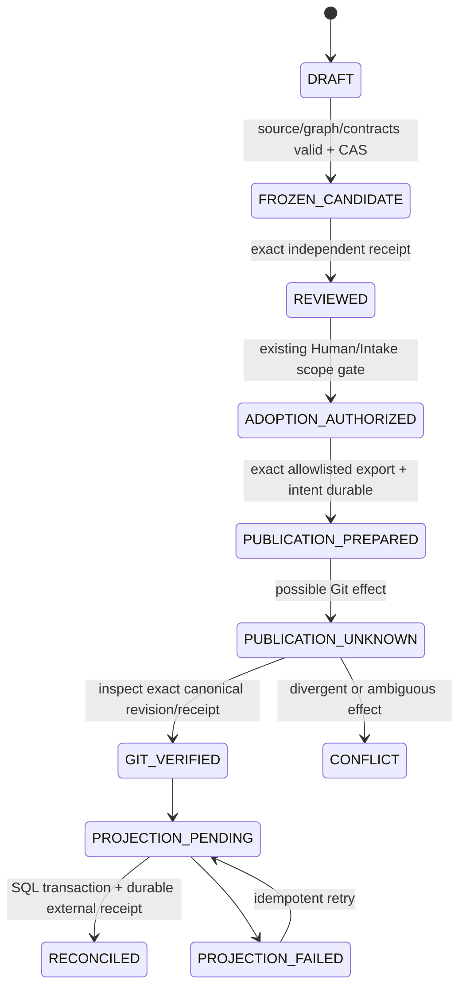

# MA12 — Git／PostgreSQL／Artifact Authority 與 Versioned Publication

Revision `candidate.4`；Owner existing Reviewer／Intake／Integrator／Publisher／ProjectionImporter；AUTHOR_CHECKED／FORMAL_REVIEW_PENDING。

## Purpose／Source／Reuse

A+與 STEP4CG3/CG5：SQLdraft/history/query；Gitaccepted 正式 Registry/contracts/source；ArtifactStore immutablebytes；既有 WORK/Review/Intake 正式接受。Sourceintegration≠formaladoption，publisher 不創造 ArchitectureAcceptance。復用 existing authority receipts、R01exactbinding、R05 accounting、R06intake applicability；不 newAcceptanceEngine。

## Single Source／Role Matrix

| Role | 可寫/提出 | 審核/發布/接受邊界 |
|---|---|---|
| Human Owner | scope/risk/exactdecisionreceipt | exactadoption/runtimegrant；不以普通 chatcopy 當已 materializedreceipt |
| Architect | chapter/registrydraft/addendum/closurecandidate | authorcheck，不能自 IndependentAccept |
| WORK/Compiler | compile/schedule/claim/cost/resultintake existingcontracts | notarchitecturepublisher 或新增 SQLauthority |
| Executor CODEX/GPT/LM |合法 WOexactfiles/diff/tests/evidence | no scope/authorityextension |
| Independent Reviewer | frozenexactsubjectverdict | 不改 subject、不自動 push/dispatch |
| Integrator | exact reviewed blobs 組合與 compatibilityevidence | integratematerial≠extendacceptance |
| Git Publisher | 被授權 subjectexport/commit/push/verify（未來） | 無 grant 不能發布；不能加未審變化 |
| SQL RegistryWriter | scopeDraft/entityrevision/event 索引 | 不 writeacceptedhead/accepted=true |
| ProjectionImporter | verifiedformalsnapshot→SQLderivedformalprojection | 無 adoptionreceipt 不擴大 scope |
| ArtifactWriter | append bytes/capture receipts | capture 安全/contentavailability 不等 specacceptance |

## Models／Review Subject／Impact Rules

PublicationCandidate 含 candidateID/baseformalhead/Draftheads/generations、exactentityrevisions/relations/codealiases、contenthashdomains、sourceallowlist、artifactrequiredclosure、scope/ownerdecisionreceipts、proposedexportmanifest。ReviewSubject 固定：rootentityrevisions＋relevantrelationshipclosure＋dependentcontracts/qualification/evidencebinding＋registrysnapshot/sourcehash＋explicitexclusions/compatibilityassumptions；reviewreceipt 指 subjectdigest 不指可變 branchname。

Closure 規則：include 所有 changednode/edge 及影響其語義的 parent、codepolicy、deps/transitiveprerequisites、spec/contracts/runtimeadmissioninputs；dependency 改變再包含 reverseconsumers 的 impactlist（不是強制把全部歷史接受作廢）。只重審 changedbehavior 以及證明兼容所需鄰域；全 snapshot graph cycle/uniqueness 檢驗仍須完整。unrelatedentitycommentchange 只變自身 rev，不使 allEvidence 失效。consumer 若聲明 pinnedoldcontract 且語義兼容，舊 evidence 保持 historicvalid，新 headapplicability 可證明；missingproof=NEEDS_REQUALIFICATION。

Evidence 狀態區分 HISTORIC_VALID、CURRENT_APPLICABLE、CURRENT_INAPPLICABLE、UNVERIFIABLE；變新 dependency 不 rewritehistoricalPASS，只撤 currentapplicability。舊 GAP08 證據 quallevel/subjectscope 不能傳播為 P08integration。Exactreviewbindings 變化必須 newsubject/review，不 copyreceipt。

## Publication State Machine／Transitions

Review 可先獨立內容審核、Humanscope 授權、實際 Gitpublication 三個 receipt 不同。Grant 定義 repo/branch/baseSHA/exactfilemanifest/contentdigest/allowedoperation/expiry/actor；PublicationPrepared 在 SQL 與外部 durablejournal 都有 intent，不能 SQLlost 后丟 unknownGitaction。Gitcommit 可能形成但未 canonicalbranch 整合：materializedcandidate 不是 formalhead；只有 canonicalbranch/authorizedadoptionbinding verified 才 formalpublished。

Gitcommit 和 SQLtransaction 不可2PC 假設。Publisher 固定 exportbytes/CASbasehead，Gitstage/commit/push 未來操作有 exactgrant；結果 unknown 查詢 repoHEAD/commit/tree/subjectmanifest/authorreceipt，不盲 newcommit。Githeadchangedcompatible 且 expectedsubject 仍 exact，按 grant 決定 rebase/重新授權；不能自行 merge 未審別的文件。Projection 先 verifiedGit→SQLtransactionapplysnapshot+headCAS+commandreceipt→externalReconciliationReceipt，pending/unknown 可恢復。

## Failure Matrix／Event Evidence／Human

| Case | 拒絕/預期 | 恢復/證據/Human |
|---|---|---|
| A SQLDraft 無 Git | Draftonly，不 formal | 保 draftreceipt；下一合法 review/publication |
| B review 后 writer 改 graph | frozenmanifest 不變；新 draft 不是 reviewed | subjecthash/generationdiff→newcandidate；scopeimpact 需 review |
| C Git 成功 SQL 失敗 | Gitformalvalid、projectionSTALE | verifiedGitreceipt＋pendingjournal，冪等 import；無需重新 accepted |
| D candidateGit 失敗 | formalhead 不變 | proven-no-effectreceipt 后 retryexactintent，basehead 漂移需 revalidate |
| E Git 成功 acklost | UNKNOWN 不 failnoeffect | querycommit/tree/authorizedcanonicalbranch；唯一 matchreconcile，多 matchHuman |
| F eventduplicate | sameIDhash no-op | originalcommandreceipt/effectreturn |
| G eventIDdiffhash | CONFLICT，不覆蓋 | quarantineaudit、Humanintegrityreview |
| H import 舊 revision | 不 rollbackformalhead | ancestry/snapshotheadCAS；歷史 archive 可 import 但不 current |
| I privatespec 丟失 | identity/contracts 仍在、availabilityMISSING | 從 privatebackupexacthash 恢復；無 bytes 不造文 |
| J wrongartifacthash | CORRUPT，不能 RESTORED | quarantine/providerretry/backuprestore，Human 損失 disposition |
| K acceptedcapdeps 新變 | 原 review 不能涵蓋 newedge | exactimpactclosure/newrevisionreview；舊 history 保留 |
| L SQLaccepted=true | unauthorized，拒絕 formalwrite | AuthZ/audit；從 Git 重建投影，Humansecurityinvestigation |
| M SQLclearGitrebuild | sameIDs/alias/relationships/bindings | importerreceipts+graph/hashcomparisons，無 newacceptance |
| N GAP08→P08acceptance | type/scope 不匹配拒絕 | REUSESedge＋P08integrationqualificationgate |
| O LABsamecode | contextcatalog 隔離 | scopedaliaslookup，ambiguousHumanmappingsource，不 merge |

## Projection Import／Canonicalization／安全

Import 輸入：verifiedrepositoryidentity/commit/registrymanifest/schema 版本/ownerreceipts/sourcebindings；無網絡 wildcardautodiscovery。檢查 filehash/typedIDs/FKs/fullgraph/uniqueness/ownership/version/codegrammar/Evidencequalification、allowlist/privacy；SQLtransaction 按 event/snapshotIDunique 與 GenerationCAS apply，新 head ancestrycompatible；中斷不留半 appliedhead。Receipt 包含 inputcommit/snapshot/base/appliedhead/eventfrontier/changedcounts/validation/replaystatus/hash。再 importsameIDdiffbytes fail，samebytesno-op。Drafthead 與 formalprojectionhead 互不偷換。

ExportstableUTF8/LF、schema-definedsortedsets/stableIDs/numberrepresentation、explicitnull/default 語義；hash domains `raw_bytes_sha256`／`registry_semantic_v1`與`git_blob_sha1`分開，無跨 domain 直接比較。Canonicalizationversion 變更 newcontractreview；不因 prettyprint 改 semantic 或 SourceBinding。

只 exportnamedformalidentity/contracts/relations/acceptedreceipts 安全 metadata；拒絕 `.env`、secrets、SQLdump、privatehistory/rawtrades/nativelogs/fullchat、絕對 privatefilesystemlocators。Pathvalidatedallowlistedroot＋normalizedrelativepath；拒絕 absolute/traversal/UNC/device/ADS/ambiguouscase/reparseescape；open/finalresolvedpath 驗證與 copy 時 TOCTOU 防護。Hash 是驗證完整性不是安全掃描/authority。SQL-PREFLIGHT_RF01 僅它本身受限 scope104authorchecks，不是 URMS 安全 runtimePASS。

## Git-only Closure／Interfaces／Acceptance／Handoff

Git 必須保 canonicalentities/revisions、namespace/typedsegments/formats/aliases、product/worktrees、typeddeps/crosswalk、snapshotmembers、necessaryschemas/migrations/contracts、acceptedsource/evidencebindings、privateartifactopaqueID/hash/version/availability；依賴 private 詳細 spec 不能讓 formalgraph 無法重建。UI/APIcandidate 操作只 draft，正式 publish 操作 futureexplicitgrant；Reviewers 讀取 immutablebundle 不 mutableSQLhead。

測試：A–O 模型 failure/cut/CAS/idempotency、canonicalroundtrip、sameIDdiffhash、crossgraphimpact、privateexportdeny、path/reparse/windowscaseduplicates、commitackunknown、oldprojectionstale。真正 Git/SQLcrash/fs 測試在隔離 qualification，不本次執行。客觀接受：no competingwriter/acceptance、exactclosure、unknownrecoverydurable、Gitrebuild 同 IDs/relations 與 missing 私有狀態、歷史 receiptimmutable。WORK 帶 failurematrix/closurealgorithm/sourceallowlist，不授權 autoGit/SQL。

## 本次有界補充契約

[REGISTRY_EXPORT_ADAPTER.md](REGISTRY_EXPORT_ADAPTER.md) 為本章不可省略的候選 companion；typed resource/obligation、T12 witness、export adapter 與 exact dependency/source bindings 必隨章節 subject 一起編譯及審核。原 accepted predecessor 不變。

## RCG02 / RCG05 typed import and private coverage

ProjectionImporter輸入必包含CodeAllocation/tombstones、RelationValidity/RelationSourceRecord、exact SourceSnapshotBinding以及whole connected graph CAS；source-only關係不要求inventedfrom日期。Private history backup另固定OwnerInventory/ExternalCaptureJournal cut；SQL projection成功不證私有原文完整。詳[Registry correction](REGISTRY_IDENTITY_AND_VALIDITY_CONTRACTS.md)及[Private inventory correction](PRIVATE_INVENTORY_BACKUP_CONTRACTS.md)。原publication state machine／unknown outcome／existingAcceptance owners不變。

## Candidate.5 有界修正承接

Review subject cold read resolves exact frozen relevant closure through same catalog; visibility/capture/index/A/B/Acceptance independent. Required missing body disallows COMPLETE semantic review claim.

唯一詳細契約：`BODY_CAPTURE_READBACK_CONTRACTS.md`。原已接受範圍與尚未完成qualification保留。

## Cycle 02 有界後繼契約（設計候選；沒有採納或施工授權）

本章的受影響消費者使用 `MA-ARCH-REVIEW-v6-CYCLE02` 的 MODEL／TYPE／API 精確版本。來源與 plan revision 是 `candidate.6`；傳輸協定是獨立的 `MA-DTO-v6`。不得將 `candidate.4/5/6` 當 wire alias。原接受 P00 設計、永久身份、舊 Wave／Feature 語義及 v5 完整前驅 bytes 保留。

Registry：`CC02_AUTHOR_ADDENDUM.candidate.v6.md`、有限內部 producer allowlist、source-file resolver 及封閉來源正文型別。PAPER／compiler／wire／單元：`ENGINEERING_ADDENDUM.candidate.v6.md`。resolver 依原來源 owner、權限、immutable source bytes 與 schema 驗證；capture、索引與 A/B protection 不能互推。compiler 的 HOLD 和 READY 都固定完整輸入；source-compatible 設計檢查與 qualified producer result 分開。

本輪具體測試世界是合成設計預期值，`EXPECTED_NOT_EXECUTED`，不代表任何實際 DB、Broker、PAPER、Controller、還原或執行。`95_OPERATION_VALUE_COVERAGE.candidate.v6.json` 明列尚未補足的正例；negative wire case 不替代 positive domain oracle。舊 v5 fixture 原文保留，但只能作前驅/版本相容或回歸輸入，不能被推導為本輪當前 wire 實作證據。
